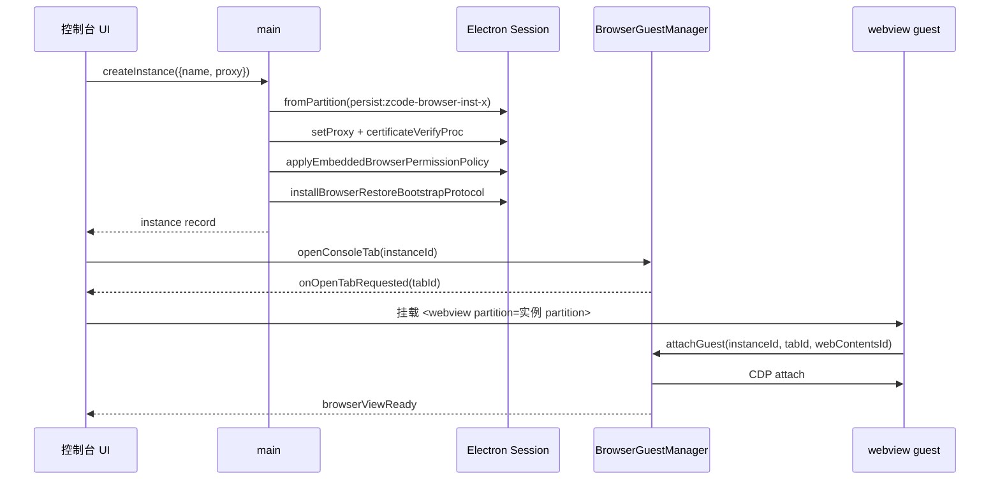
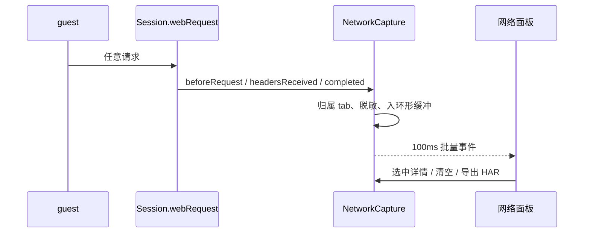
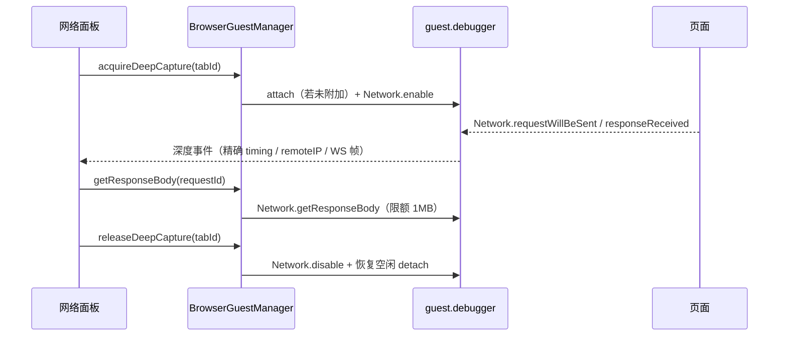
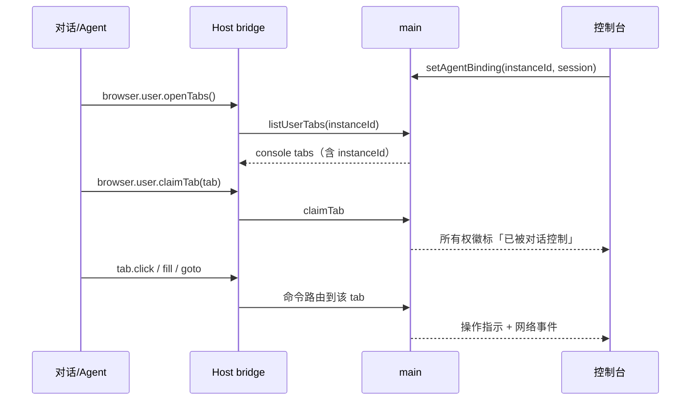
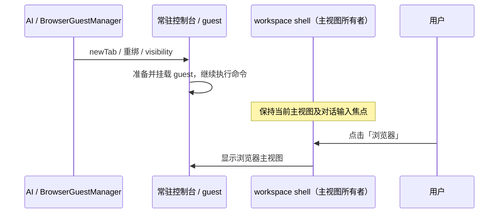

# 176 · 浏览器控制台（多实例 / 独立代理 / 网络与页面面板）

> 状态：**阶段 1–8 已实现**（实例注册表 / 独立 partition / 每实例代理 / 主视图与标签 / 网络浅采集与 CDP 深采集 / 页面编辑与表单 / AI 绑定与认领 / 站点权限按 partition 隔离 / 配额与恢复）。当前仍不支持：代理认证、原始抓包、每标签独立代理、控制台标签的显式内存预算挂起。

## 0. 读了什么 / 结论一致性

| 材料                                                                                                 | 结论                                                                                                                                                                         |
| ---------------------------------------------------------------------------------------------------- | ---------------------------------------------------------------------------------------------------------------------------------------------------------------------------- |
| 根 `AGENTS.md`、`DESIGN.md`                                                                          | 主视图、状态所有权、UI 语义 token、桌面优先与响应式约束按现有规则执行。                                                                                                      |
| `docs/development/embedded-browser-permissions.md`                                                   | 内置浏览器是 Electron `<webview>` + 固定 partition `persist:zcode-embedded-browser`；权限 fail-closed；CDP 空闲后主动 detach 是防主进程 UAF 的硬约束。本设计必须继承这三条。 |
| `docs/development/embedded-browser-permissions.md`                                                   | 权限 UI 与数据清理已落地；清理语义是真实 Electron session 语义。                                                                                                             |
| `docs/development/architecture.md`                                                                   | `desktop` / `ui` / `shared` 为 legacy 模块；新增交互仍先补契约，单文件上限 400 行。                                                                                          |
| `docs/development/upstream-sync.md` F9 行                                                            | UI 集成已接线（提示条、站点权限页、main bridge 均可在源码中定位）；本设计沿用同一结论。                                                                                      |
| `packages/desktop/src/main/browserView/browserGuestManager.ts`                                       | 已有 tab 生命周期、CDP attach/detach、截图、录制、residency、恢复、下载跟踪；tab owner 由 `browserId + windowId + workspaceKey + sessionId` 决定。                           |
| `packages/desktop/src/main/browserView/browserCommandExecutor.ts` 及各 handler                       | Agent 已能 navigate/click/fill/type/select/check/drag/snapshot/evaluate/playwright 等；本需求不需要重造执行器。                                                              |
| `packages/desktop/src/main/desktopWindowChrome.ts`                                                   | `will-attach-webview` 做协议白名单、guest 硬化、popup 路由；阶段 1 已补控制台 partition 的一次性 attach 白名单。                                                             |
| `packages/desktop/src/main/desktopNetworkPolicy.ts`                                                  | 全局 `httpProxy` 只应用到 `defaultSession` 与内置浏览器 partition；代理是 session 级，不是 tab 级。                                                                          |
| `packages/desktop/src/main/embeddedBrowserPermissionPolicy.ts` / `embeddedBrowserSitePermissions.ts` | 权限策略按 session 安装；站点同意记录当前按 origin 全局存，不区分 partition。                                                                                                |
| `packages/ui/src/browser-use/UnifiedBrowserView.tsx`、`EmbeddedBrowserPaneParts.tsx`                 | 已有完整浏览器 chrome：地址栏、前进后退、刷新、元素拾取、DevTools、响应式视口、权限提示条。                                                                                  |
| `packages/ui/src/hooks/useAppPanels.ts`、`lib/workspaceSidePane.ts`                                  | 现有浏览器是**对话侧边栏**的 tab，按 workspace/session 归属，单 window 内可多 tab。                                                                                          |
| `apps/zcode-cli/packages/browser-use-plugin/docs/*`                                                  | Agent 侧已有 `agent.browsers.list/getDefault`、`tabs.list/get/new`、`user.openTabs/claimTab`、`visibility`；模型已被教导“优先认领用户已打开的 tab”。                         |

**一致性结论**：本设计沿用 150/165/175 的权限与隔离边界，F9 接线可在源码中定位。浏览器主视图、多实例、独立代理与网络面板已在本专题落地，复用现有浏览器引擎。AI 事件只驱动后台标签，不改变用户选择的主视图。

## 0.1 落地范围

已实现（阶段 1–8）：

- `packages/shared/src/browser-console/`：实例/代理/标签/网络/检查器/AI 绑定契约与错误码，默认实例与 partition 前缀常量。
- `packages/desktop/src/main/browserConsole/`：
  - `browserInstanceStore.ts`：实例注册表、`userData/browser-instances.json` 原子写、损坏文件保留、重复 partition 丢弃、默认实例固定 `inherit`、限额。
  - `browserProxyConfig.ts` / `browserConsoleNetworkPolicy.ts`：代理归一化、证书策略；`fixed` 端点非法显式失败；改代理只重装网络策略。
  - `browserInstanceSession.ts` / `browserConsolePartitionGuard.ts`：固定顺序装配（网络 → 权限 → 恢复协议 → attach 白名单）与按窗口一次性 attach 许可。
  - `browserConsoleRuntime.ts`：实例 CRUD、创建失败回滚、删除前清数据、懒恢复、孤儿 partition 启动清理。
  - `browserConsoleTabRegistry.ts` / `browserConsoleAgentBinding.ts`：tab 归属（每实例上限 20）与 `window + workspace + session → instance` 显式绑定。
  - `browserConsoleNetworkCapture.ts` / `browserConsoleNetworkCdp.ts` / `browserConsoleNetworkHar.ts`：`webRequest` 浅采集环形缓冲、100ms/200 条批处理、敏感头脱敏、HAR 导出；CDP 深采集事件映射。
  - `browserConsoleDeepCapture.ts`：深采集租约与实例归属校验（CDP attach/detach 仍由 `BrowserGuestManager` 持有）。
  - `browserConsoleIpc.ts`：实例、tab、网络、深采集、AI 绑定 IPC，入参 main 侧重新校验。
- `packages/desktop/src/main/browserView/browserGuestManager.ts`：console tab 语义（`consoleInstanceId` / 可认领 / 收回）、深采集租约期间禁止 CDP 空闲 detach、`Network.*` 事件出口。
- `packages/desktop/src/main/embeddedBrowserSitePermission*`：站点同意记录迁移为 `partition → origin → permission`，设置页仍读写默认 partition。
- `packages/desktop/src/main/index.ts`：控制台运行时装配、guest 绑定、绑定会话 `newTab` 路由到控制台、窗口关闭清理。
- `packages/ui/src/browser-console/`：`BrowserConsoleView`、`InstanceStrip`、`ConsoleTabStrip`、`BrowserConsoleViewport`、`NetworkPanel`、`PageInspector`；标签壳按 workspace 持久化，重启只挂载活动标签。
- `packages/ui/src/app-shell/` 与 `WorkspaceSidebar.tsx`：`WorkspaceMainView = "browser"`、侧边栏入口（仅桌面）、主视图常驻挂载、返回键退出浏览器。

单测：`browserInstanceStore`、`browserProxyConfig`、`browserConsolePartitionGuard`、`browserInstanceSession`、`browserConsoleRuntime`、`browserConsoleTabRegistry`、`browserConsoleAgentBinding`、`browserConsoleNetwork`；`embeddedBrowserPermissionGovernance` 覆盖 store v2 迁移与按 partition 隔离。

仍不支持（明确非目标）：代理认证、代理出口测试、实例缓存大小展示、原始 TCP/UDP 抓包、每标签独立代理、控制台标签的显式内存预算挂起（默认驻留，超限由既有 residency 机制处理）、Chrome 扩展/同步/书签/历史。

## 1. 结论先行

收起侧栏时，实例工具栏通过窗口壳的 --workspace-view-toolbar-inset 避让顶部浮层。该值由 DesktopTopOverlay 测量交互按钮组产生，展开侧栏归零；工具栏保留原有实例状态，不因收起而重建 guest。

1. **不做第二个浏览器引擎**。新入口 = 在现有 `<webview>` + `CDP-on-guest` + `BrowserGuestManager` 上增加一个 **owner surface（控制台）**，复用导航、标签、截图、录制、权限、弹窗、恢复与 Agent 命令。
2. **实例是隔离单位**。一个实例 = 一个持久 partition = 一份 Cookie/Storage = 一套代理。Electron 没有 tab 级代理，**“每个实例单独代理 IP”只能靠独立 session 实现**；同一实例内的 tab 共享代理与登录态。
3. **默认实例复用现有 partition**。`persist:zcode-embedded-browser` 成为“默认浏览器”实例，既有 Cookie 与侧边栏浏览器不变；新实例使用 `persist:zcode-browser-inst-<uuid>`。默认实例的代理在 v1 固定为“跟随全局”，不提供自定义覆盖入口；需要独立 IP 请新建实例。
4. **网络面板分两层**：`session.webRequest` 常开做浅采集（URL/方法/状态/头/近似耗时），CDP `Network` 域按需租约做深采集（响应体、精确 timing、远程 IP、WebSocket 帧）。不能承诺“原始 TCP 包”。
5. **AI 控制走显式绑定且默认关闭**。控制台是用户浏览器，不默认被某个对话接管；用户打开“AI 控制此浏览器”后，当前会话通过既有 `browser.user.openTabs()` / `claimTab` 或新 tab 命令操作该实例。
6. **控制台切走不销毁网页**。主视图切回对话时，控制台 guest 继续驻留，超过内存预算再按现有 residency 机制挂起；否则“让 AI 操作浏览器、我回对话看结果”不成立。

## 2. 目标与非目标

### 目标

- 侧边栏新增「浏览器」入口，主内容区呈现一个可日常使用的 Chromium 浏览器。
- 多开浏览器实例：每个实例独立 Cookie/登录态、独立代理、独立标签页。
- 实例内多标签：新建、关闭、切换、恢复、弹窗路由、快捷键。
- 右侧检查器：
  - 网络：当前站点/当前标签/全部标签的请求列表与详情；
  - 元素：选中、修改文本/属性/HTML；
  - 表单：枚举字段、批量填充、让 AI 填写。
- AI 可通过既有 browser-use 工具控制被绑定的实例，并能认领用户手动打开的 tab。
- 复用既有权限治理、证书策略、弹窗路由、下载跟踪、截图与录制。

### 非目标（v1）

- 原始 TCP/UDP 抓包（需要 OS 级权限与驱动，见 §9.6）。
- Chrome 扩展安装、Chrome 账号同步、书签/历史云同步。
- 每标签独立代理（Electron 不支持；需要拆实例）。
- 手机/Web 远控里的完整浏览器控制台（桌面专属；远控边界见 §11.7）。
- 完整 DevTools 替代品；复杂 SPA 编辑器的结构化编辑。
- 密码管理器、自动登录、指纹伪装等风控对抗能力。

## 3. 现状与差距

| 能力                | 现状                                                      | 代码位置                                                                      | 差距                                         |
| ------------------- | --------------------------------------------------------- | ----------------------------------------------------------------------------- | -------------------------------------------- |
| 主视图              | `chat` / `automations` / `plugin-store` / `browser`       | `packages/ui/src/app-shell/types.ts`                                          | 无                                           |
| 侧边栏入口          | 自动化、插件市场、浏览器（仅桌面）                        | `packages/ui/src/WorkspaceSidebar.tsx` 的主导航按钮区                         | 无                                           |
| 浏览器引擎          | `<webview>` + CDP-on-guest                                | `packages/ui/src/browser-console/BrowserConsoleViewport.tsx`                  | 复用既有引擎，未另造第二套                   |
| 多标签              | 控制台自己的标签条与 owner surface                        | `browserConsoleTabRegistry.ts` / `ConsoleTabStrip.tsx`                        | 无                                           |
| 多实例/独立 profile | 实例注册表 + partition 工厂                               | `browserInstanceStore.ts` / `browserInstanceSession.ts`                       | 无                                           |
| 独立代理            | 实例级 `setProxy`                                         | `browserConsoleNetworkPolicy.ts`                                              | 仅无认证代理                                 |
| 网络抓包            | 浅采集 + CDP 深采集（非原始 TCP）                         | `browserConsoleNetworkCapture.ts` / `browserConsoleNetworkCdp.ts`             | 不提供原始抓包                               |
| 页面编辑            | 文本/属性/HTML/样式编辑、表单扫描与批量填充               | `packages/ui/src/browser-console/PageInspector.tsx` / `inspectorScript.ts`    | 无撤销栈；跨域 iframe / closed shadow 不可达 |
| Agent 控制          | 显式绑定 + console tab 认领 + 绑定会话 `newTab` 路由      | `browserConsoleAgentBinding.ts` / `browserGuestManager.ts`                    | 无新工具名，只扩展既有参数与返回字段         |
| 权限治理            | fail-closed，每个实例 partition 都装配                    | `desktopWindowChrome.ts` / `browserInstanceSession.ts`                        | 无                                           |
| 站点同意记录        | 按 `partition + origin` 隔离                              | `embeddedBrowserSitePermissions.ts` / `embeddedBrowserSitePermissionStore.ts` | 设置页仍只展示默认 partition                 |
| 数据恢复            | 实例注册表持久化；标签壳按 workspace 恢复并只挂载活动标签 | `browserInstanceStore.ts` / `consoleTabsStorage.ts`                           | 不恢复页面历史与表单                         |
| Web/手机            | 无 webview；入口隐藏                                      | `supportsEmbeddedBrowser` / `WorkspaceSidebar.tsx`                            | 控制台为桌面专属                             |

## 4. 产品设计

### 4.1 入口与布局

侧边栏第三项之后增加「浏览器」（Globe 图标）。点击进入 `workspaceMainView = "browser"`，隐藏 WorkspaceHeader 的对话头部，由浏览器自带 chrome 占据右侧内容区。

```
┌ 实例条：[默认] [工作号] [购物] [+ 新建]                         ┐
│ 标签条：[标签 1] [标签 2] [+]                                    │
│ 工具栏：← → ⟳  [ 地址栏 ]  站点权限  元素拾取  DevTools  ⋯        │
├───────────────────────────────────────────────┬─────────────────┤
│                                               │ 检查器（可收起） │
│                 <webview>                     │ 网络 | 元素 | 表单│
│                                               │                 │
└───────────────────────────────────────────────┴─────────────────┘
```

- 实例条用横向 chip，不再增加第二条左侧导航；避免与全局侧边栏抢视觉层级。
- 顶部窗口导航的返回键在浏览器主视图内表示「退出浏览器回到对话」；页面历史只由浏览器工具栏的 ← / → 控制，两套历史不混用。
- 检查器默认收起，按钮带 `aria-expanded` 与快捷键提示；窄窗口退化为覆盖式抽屉。
- 实例与标签都支持中键关闭、右键菜单（重命名、复制 URL、清除数据、删除）。
- 空状态：没有实例时展示「新建浏览器」与三条说明：独立 Cookie、独立代理、AI 可控制。

### 4.2 实例

创建流程只问三件事：名称、颜色（可选）、代理（默认「跟随全局」）。创建后立即创建一个空白标签。

实例菜单：

- 重命名 / 改色；
- 代理设置：跟随全局 / 直连 / 跟随系统 / 自定义（HTTP、HTTPS、SOCKS5 + bypass 列表）；当前阶段只支持无认证代理，带用户名密码的代理在后续阶段接入；
- 测试出口：手动发起一次探测请求，显示出口 IP（见 §8.4）；当前阶段未实现。
- 清除数据：只清缓存 / 清全部（复用既有两种语义）；
- 删除实例：关闭全部标签 → detach CDP → 清 storage/cache → 移除注册表 → 标记 partition 待清理。

实例数量与每实例标签数设产品上限（建议默认 8 / 20，可配置），超限显式报错，不静默淘汰用户页面。

### 4.3 标签与生命周期

- 新建标签默认 `about:blank` 并聚焦地址栏；`target=_blank`/`window.open` 继续按现有 popup 路由落到同实例新标签。
- 标签归属写清楚：`ownerKind: "console"`，`instanceId`，`workspaceKey`，`windowId`；不由某个对话预占。
- 控制台切回对话时：
  - 默认保留 guest（隐藏但驻留），使 AI 可持续操作、返回时保留页面状态；
  - 控制台宿主挂在 `WorkspaceShellLayout` 级别，由 `workspaceMainView` 只控制可见性，**不能条件卸载**；否则切回对话会销毁 guest，AI 操作与页面状态同时丢失；
  - 后台标签超过内存预算时按现有 residency 机制挂起，UI 显示「已挂起，点击恢复」；
  - 隐藏期间 Agent 截图复用现有 screenshot surface 协调器（与侧边栏浏览器同一套 fixed 合成层），不另造截图路径；
  - 关闭窗口时全部释放，不跨窗口搬运 guest；下次启动只恢复 logical shell。
- 键盘：`Ctrl/Cmd+T` 新标签、`Ctrl/Cmd+W` 关闭、`Ctrl/Cmd+L` 聚焦地址栏、`Ctrl/Cmd+Shift+A` 检查器、`F5`/`Ctrl+R` 刷新、`Alt+←/→` 历史。与全局快捷键冲突时以浏览器焦点域为准。
- guest 会先吃掉按键，因此浏览器快捷键必须在 main 的 guest `before-input-event` 或 renderer 的捕获阶段处理；实现时确认桌面三平台一致，不能只在 macOS 可用。

### 4.4 检查器

**网络**：见 §9。

**元素**：

- 进入拾取模式后 hover 高亮、点击选中；选中后显示标签名、选择器、尺寸、文本。
- 可编辑：文本内容、`value`、属性名/值、`innerHTML`（危险操作二次确认）、内联样式（可选）。
- 只对当前可见标签生效；执行前读取旧值，写入后回读校验，失败给出原因而不是假装成功。
- 撤销栈按标签保存，导航/刷新即失效；不写磁盘。

**表单**：

- 枚举 `input/select/textarea/[contenteditable]`，显示 label、name、type、当前值、是否必填。
- 单字段填写与批量粘贴 JSON；支持「让 AI 填写」——把 URL、字段清单、当前值与页面快照上下文交给当前对话，AI 用既有 `fill/select/check` 命令完成。
- 密码字段默认遮蔽值、不进入撤销栈、不写入日志。

### 4.5 “正常浏览器”范围

v1 必须具备：标签、地址栏（URL + 搜索）、前进后退、刷新/停止、缩放、页内查找、下载列表、右键菜单、DevTools、弹窗、会话恢复、错误页、站点权限、代理。

明确后置：扩展、书签、全局历史、打印/PDF、Chrome 配置导入、阅读模式。实现时必须在空状态/设置页说明边界，不能宣称与 Chrome 等价。

## 5. 领域模型与状态所有权

| 状态                                           | 唯一所有者                           | 持久化                                        | 读取方                  |
| ---------------------------------------------- | ------------------------------------ | --------------------------------------------- | ----------------------- |
| 实例注册表（id/name/color/proxyRef/createdAt） | main `BrowserInstanceStore`          | `userData/browser-instances.json`，原子写     | UI、main                |
| partition / 代理 / 证书策略                    | Electron `Session`                   | Electron 自身分区目录                         | 该实例全部 guest        |
| 代理凭据                                       | main，`safeStorage` 加密（后续阶段） | `browser-instances.json` 的密文块或系统钥匙串 | 仅 main 的代理认证路径  |
| 标签所有权与 lifecycle                         | main `BrowserGuestManager`           | 既有 recovery store（扩展 instanceId）        | UI、Agent               |
| 控制台标签条/激活态                            | renderer（按 window）                | 仅内存；重启从 main shell 恢复                | UI                      |
| 网络浅采集环形缓冲                             | main（按实例）                       | 默认不落盘                                    | 网络面板                |
| 深采集租约                                     | main（按 tab）                       | 不持久化                                      | 网络面板、Agent（可选） |
| 页面编辑撤销栈                                 | renderer（按 tab）                   | 不持久化                                      | 元素面板                |
| AI 绑定（session → instance）                  | main（按 window/workspace/session）  | 可选持久化                                    | Agent 路由、UI 徽标     |
| 站点权限                                       | main（按 partition + origin）        | 既有 JSON 迁移                                | 权限提示条、站点权限页  |
| 浏览器显示偏好                                 | 既有 settings                        | setting service                               | `HumanBrowserView`      |

不变量：

1. 一个 tab 只属于一个实例；tab 的 guest session 必须等于该实例 partition。
2. 一个实例的 partition 与代理只在创建/编辑实例时变更；不允许多个实例共享 partition。
3. 一个 tab 同一时刻只有一个“控制者”：用户、某个对话，或无人。认领是显式状态迁移，不能靠 URL 猜测。
4. 网络采集只保留内存环形缓冲；用户导出 HAR 才产生文件。
5. 页面编辑只改当前标签的 DOM，不进入持久存储，不跨导航保留。

## 6. 架构与接口

### 6.1 模块划分

- `packages/shared/src/browser-console/`：实例、代理、标签、网络、检查器、AI 绑定的 zod schema 与类型。
- `packages/shared/src/channels.ts` / `platform.ts` / `index.ts`：新增通道与 `IPlatformService` 方法。
- `packages/desktop/src/main/browserConsole/`：
  - `browserInstanceStore.ts`（注册表 + 原子写 + 迁移）
  - `browserInstanceSession.ts`（partition 创建、代理、证书、权限、恢复协议装配）
  - `browserProxyConfig.ts`（规则归一化、凭据解析、测试出口）
  - `browserConsoleNetworkCapture.ts`（webRequest 浅采集、环形缓冲、脱敏）
  - `browserConsoleDeepCapture.ts`（CDP 租约、Network 域、body 读取）
  - `browserConsoleIpc.ts`（实例 CRUD、网络订阅、绑定）
- `packages/desktop/src/main/browserView/`：扩展现有 manager（instanceId、console owner、tab 路由），不复制执行器。
- `packages/desktop/src/preload/`：暴露新通道。
- `packages/ui/src/browser-console/`：`BrowserConsoleView`、`InstanceStrip`、`ConsoleTabStrip`、`BrowserConsoleViewport`、`NetworkPanel`、`PageInspector`（含表单模式）与 hooks。
- `packages/ui/src/app-shell/`：`WorkspaceMainView = "chat" | "automations" | "plugin-store" | "browser"`，入口与渲染分支。
- 文案：`packages/ui/src/i18n/`；测试 id：`packages/shared/src/test-ids.ts`。

### 6.2 数据模型（类型草图，不是实现）

```ts
type BrowserProxyConfig =
  | { mode: "inherit" } // 跟随全局 httpProxy / 系统
  | { mode: "direct" }
  | { mode: "system" }
  | {
      mode: "fixed";
      protocol: "http" | "https" | "socks5";
      host: string;
      port: number;
      username?: string;
      passwordRef?: string; // 仅密文引用，渲染层只看到 hasCredentials
      bypassRules?: string[];
    };

interface BrowserInstanceRecord {
  id: string; // 默认实例固定为 "default"
  name: string;
  color?: string;
  partition: string; // persist:zcode-embedded-browser | persist:zcode-browser-inst-<uuid>
  proxy: BrowserProxyConfig;
  createdAt: number;
  updatedAt: number;
}

interface BrowserNetworkEntry {
  id: string; // webRequest id 或 CDP requestId
  instanceId: string;
  tabId: string | null; // service worker 未归属时为空
  frameUrl?: string;
  source: "webRequest" | "cdp";
  method: string;
  url: string;
  resourceType: string;
  statusCode?: number;
  statusLine?: string;
  requestHeaders?: Record<string, string>;
  responseHeaders?: Record<string, string[]>;
  fromCache?: boolean;
  error?: string;
  startedAt: number;
  responseStartedAt?: number;
  completedAt?: number;
}
```

Agent 协议只增加可选字段，保持向后兼容：

- `BrowserCommandContext.instanceId?: string`（缺省 = 会话绑定实例；再缺省 = 默认实例）。
- `BrowserTabSummary.instanceId?: string`、`ownerKind?: "session" | "console"`。
- `newTab` 增加可选 `instanceId`；`listUserTabs` 返回 console tab 及其实例。
- 不把代理密码、Cookie、Authorization 放进任何 Agent 可见字段。

### 6.3 IPC / 平台接口

新增（实际名称以 `packages/shared/src/platform.ts` 为准）：

- `browserConsoleListInstances()` / `browserConsoleCreateInstance` / `browserConsoleUpdateInstance` / `browserConsoleDeleteInstance`
- `browserConsoleClearInstanceData({ instanceId, mode: "cache" | "all" })`
- `browserConsoleRegisterTab` / `browserConsoleUnregisterTab`（tab 归属登记，见 §6.5）
- `browserConsoleNetworkSubscribe({ instanceId, enabled })` / `browserConsoleNetworkSnapshot` / `browserConsoleNetworkClear` / `browserConsoleNetworkExportHar`
- `browserConsoleAcquireDeepCapture` / `browserConsoleReleaseDeepCapture` / `browserConsoleGetResponseBody`
- `browserConsoleSetAgentBinding({ workspaceKey, sessionId, instanceId | null })` / `browserConsoleGetAgentBinding`
- `browserConsolePrepareGuestAttach({ tabId, instanceId })`（webview 创建前的一次性 attach 许可，见 §6.5）
- 事件：`onBrowserConsoleNetworkBatch`（浅采集与深采集共用）、`onBrowserConsoleAgentBindingChanged`、`onBrowserConsoleOpenTab`

所有调用走 `IPlatformService`，UI 不直接触碰 `window.zcode`。

**三层都要映射，缺一层就是静默失效**：`preload`（`window.zcode`）→ `@zcode/client` 的 `window.zcode` 类型声明 → `renderer/src/desktopPlatform.ts`。
第三层最容易漏：`IPlatformService` 上这些方法是可选的，UI 用“方法是否存在”做能力探测，所以漏映射时
入口能打开、实例能点，但一点「保存」就只报「创建实例失败」，主进程日志一条都没有（IPC 根本没发出）。
回归测试见 `packages/desktop/test/desktopBrowserConsolePlatformBridge.test.ts`。

### 6.4 与现有 browser-use 协议的关系

**v1 决策**：保持**一个 browser backend**（`iab:<uuid>`），通过会话绑定选择实例。理由是改动面最小、不破坏插件对 `getDefault()` 的假设，且用户只需要“让 AI 用这个浏览器”，不需要模型理解多后端。

- 会话绑定到实例后，缺省 `newTab` 与无 `tabId` 命令落在该实例。
- 未绑定时会话行为完全不变：仍使用侧边栏默认实例。
- `listUserTabs` 返回控制台未认领 tab；`claimTab` 允许同 window/workspace 且同实例的 console tab，不要求 sessionId 相等（这是与当前 `canClaimUserTab` 的唯一语义扩展）。
- 未来若模型确实需要“按实例选择后端”，再把实例映射为多个 descriptor（协议已支持同 type 多实例），但不在 v1。

### 6.5 安全接线（必须与实例创建同批完成）

对每个新 partition，在**任何 guest attach 之前**按顺序完成：

1. `session.fromPartition(partition)`；
2. `setProxy`（若为自定义）并 `closeAllConnections()`；
3. `setCertificateVerifyProc`（沿用内置浏览器策略：自定义 CA / 可选自签名放行）；
4. `applyEmbeddedBrowserPermissionPolicy(session, …)`（否则 Electron 默认自动批准全部权限，等于回退 X4 漏洞）；
5. `installBrowserRestoreBootstrapProtocol(session.protocol)`；
6. 注册网络浅采集（若该实例开启）；
7. `will-attach-webview` 校验 `params.partition` ∈ 已注册实例 partition，且与 tab 的 `instanceId` 一致；不匹配直接 `preventDefault()`。

**partition 冒用防护**：`will-attach-webview` 触发时 main 还不知道 renderer 要挂哪个 tab。控制台必须在创建 `<webview>` 前先调用 `prepareConsoleGuestAttach({ tabId, instanceId })`，main 校验实例存在、partition 已装配、且 tabId 已登记到同一窗口/实例后写入一次性 pending 记录；`will-attach-webview` 只接受与 pending 记录一致的 `partition` + `src`，并立即消费。没有 pending 记录、或 partition 与记录不符的 attach 一律拒绝，防止被攻陷的 renderer 用一个实例的 partition 加载另一个实例的 page。tab 归属由 `browserConsoleTabRegistry.ts` 维护（每实例上限 20，跨实例/窗口复用 tabId 返回 `tab_conflict`）。

侧边栏既有浏览器保持兼容：无 pending 记录时只允许默认 partition（与今天一致）；控制台 tab **即使使用默认实例的 partition 也必须先有 pending**，否则无法区分“侧边栏默认页”与“控制台冒用默认 partition 的非默认实例 tab”。同实例多 tab 并发 attach 时 pending 按 partition 计数消费，不要求与某个 tabId 一一对应；tabId 与 guest 的一致性由随后的 `attachGuest` 校验。

代理认证（后续阶段）：

当前阶段只支持无认证代理。需要认证时按以下边界接入，不得把凭据写进实例记录的明文端口字段（仍未接入）：

- `app.on("login")` 携带 `webContents` 与 `authInfo.isProxy`；优先用 guest → tab → instance 映射取凭据。
- 无 `webContents`（如 service worker）时，用 `authInfo.host` + `authInfo.port` 反查实例代理配置；仍不唯一（两个实例共用同一代理端点但凭据不同）时拒绝并告警，不猜凭据。
- 映射不到时拒绝并记录实例 id/代理端点，不记录密码。
- 若某些请求始终没有 `webContents`，可在实例配置中改用带凭据的代理 URL（仅 HTTP/HTTPS 代理支持），但不得把凭据写进日志或 Agent 可见字段。

凭据存储：

- 只在 main 解密；渲染层与 Agent 不可见；日志只允许 `proxy=redacted`。
- 使用 `safeStorage`；不可用时降级为不保存（每次会话输入），不发明弱加密。

## 7. 关键时序

### 7.1 创建实例并打开首个标签



### 7.2 网络浅采集



### 7.3 深采集租约



### 7.4 AI 认领



## 8. 多实例与代理

### 8.1 语义

- 实例 = 隔离单位。独立 Cookie、LocalStorage、IndexedDB、Cache、权限、代理、UA 覆盖（若以后加）。
- 同一实例的 tab 共享登录态与代理；需要不同 IP 时必须新建实例。
- 两个实例之间不共享登录态；需要同账号多 IP，只能各自登录（这是 session 隔离的必然结果）。

### 8.2 代理优先级

`实例自定义 > 全局 httpProxy（设置页） > 系统代理`。

- **默认实例在 v1 固定 `inherit`**，不提供自定义代理入口；需要独立 IP 时新建实例，避免默认实例改代理连带影响侧边栏浏览器。
- 全局设置变化时，所有 `inherit` 实例重新应用；自定义实例不受影响。
- 修改代理后对**新请求**生效；已建立的 WebSocket/长连接保持旧路由。需要完全生效时由用户逐标签刷新：v1 不提供「一键刷新实例全部标签」，避免一次误点丢掉多个标签里的表单。

### 8.3 代理协议与泄漏面

- 支持 HTTP/HTTPS/SOCKS5。**当前阶段只支持无认证代理**，认证代理与 `safeStorage` 凭据在后续阶段接入。SOCKS5 的域名解析通常发生在代理侧，HTTP CONNECT 的目标域名也由代理转发；这两条是实现时必须用真实代理与站点实测确认的假设，不能只按配置写 UI。
- WebRTC：实例代理生效时对 guest 调用 `webContents.setWebRTCIPHandlingPolicy("disable_non_proxied_udp")`。
- DNS 预取与 QUIC 是 Chromium 进程级开关，**不能只对某个实例关闭**；若要做严格防泄漏，必须作为全局开关单独评估，不能在 UI 上承诺“实例级 DNS 绝对隔离”。
- 不提供代理链、自动轮换、指纹伪装；这些不是本功能目标。

### 8.4 出口测试

v1 不提供出口 IP 探测（实例菜单里没有「测试出口」）：代理是否生效以页面实际请求为准（网络面板里的目标地址与响应）。代理不可达时按 §8.6 显式报错，不静默回退直连。

后续若要加该能力，必须只在用户显式点击时通过实例 session 发一次 `net.request`（默认探测地址 `https://api.ipify.org?format=json`），不做定时探测 —— 定时探测会把用户 IP 持续暴露给第三方。

### 8.5 存储与删除

- 每个 partition 有独立缓存；v1 不在实例列表展示缓存大小（`session.getCacheSize()` 需逐实例异步查询，尚未接入），清理入口只区分「清缓存」与「清全部」。
- 清除数据复用现有两种语义：只清缓存（保留登录态）/ 清全部。
- 删除实例状态机：关闭全部标签 → 等待 guest destroyed → detach CDP → `clearStorageData()` + `clearCache()` → 删除注册表 → 标记 partition 目录待下次启动清理（运行中不直接删目录，避免 Chromium 持有句柄）。
- 孤儿 partition（注册表已无记录）在启动时扫描并延迟清理；清理失败只告警，不阻断启动。

### 8.6 失败态

- 代理不可达：实例级徽标 + 页面错误页可读提示；不能表现成“网页打不开”。
- 证书错误：沿用内置浏览器策略与错误页提示。
- partition 创建失败：创建实例失败并回滚注册表，不留下半初始化实例。

## 9. 网络面板

### 9.1 采集层级

|                              | 浅采集（常开）       | 深采集（按需租约）               |
| ---------------------------- | -------------------- | -------------------------------- |
| 数据源                       | `session.webRequest` | guest `debugger` + CDP `Network` |
| 覆盖范围                     | 该实例全部标签       | 当前选中的单个标签               |
| 请求/响应头                  | 有                   | 有（含 extra info）              |
| 状态/缓存/错误               | 有                   | 有                               |
| 响应体                       | **无**               | 有（限额、可能已被回收）         |
| 精确 timing / 远程 IP / 协议 | 无，只有近似阶段时间 | 有                               |
| WebSocket 帧                 | 只有握手             | 有                               |
| 性能/风险                    | 低                   | 需要保持 CDP attach，风险更高    |

**去重规则**：某 tab 开启深采集时，该 tab 的浅采集条目不进入列表，避免同一请求出现两条；关闭深采集后恢复浅采集，并在列表插入一条“采集模式切换”分隔标记。

### 9.2 归属

- `webRequest` 的 `webContentsId` 映射到 guest → tab；映射不到（service worker、已销毁 frame）记为 `tabId: null`，显示“Service Worker / 未知标签”。
- 请求可能早于 `attachGuest` 完成，`webContentsId` 已知但 tab 尚未映射时先按 `webContentsId` 入缓冲，映射建立后回填 `tabId`；不能因为时序丢掉首屏请求。
- iframe 请求带 frame URL，详情里显示所属 frame。
- 重定向链按 `onBeforeRedirect` 串成一条，UI 可展开。

### 9.3 列表与详情

- 列表列：时间、方法、域名/路径、状态、类型、大小（近似）、耗时（近似）、标签、来源（浅/深）。
- 过滤：全部 / Fetch+XHR / JS / CSS / Img / Media / WS / 其他；搜索 URL；按状态码/域名过滤。
- 详情：概览、请求头、响应头、Payload、预览/响应体（仅深采集）、Timing、WS 帧。
- 虚拟列表；默认只保留最近 N 条（建议 2000 条/实例或 32MB，先到先淘汰），UI 显示丢弃计数。

### 9.4 隐私与脱敏

- 默认脱敏 `cookie`、`set-cookie`、`authorization`、`proxy-authorization`、`x-api-key`、`x-auth-token`；用户可显式“显示敏感头”，状态只在当前面板会话内有效。
- 请求体中的密码/验证码字段默认不在预览中展开。
- 网络数据默认不落盘、不进遥测；导出 HAR 是显式用户动作。
- **v1 网络采集数据只给人类 UI**：不向 Agent 暴露请求列表、请求/响应头或响应体，也不新增 `browser.network.*` 工具。后续若要开放，必须另做实例级开关、脱敏与审计，不能直接复用 UI 通道。

### 9.5 性能与背压

- 事件在 main 侧批处理（约 100ms 或 200 条）再发 renderer；面板关闭时只保留缓冲，不推送。
- 高频请求（埋点、轮询）按 URL 聚合计数，列表仍可展开逐条。
- 深采集限制 `maxTotalBufferSize` / `maxResourceBufferSize` / `maxPostDataSize`，避免 CDP 自身吃内存。
- 关闭面板立即释放深采集租约，让现有“空闲 detach”重新生效。

### 9.6 边界

- 这里说的是**浏览器级 HTTP(S) 请求**，不是原始 IP 包。原始抓包需要 pcap/驱动与管理员权限，跨平台成本极高，明确不做。
- 浅采集拿不到响应体；深采集开启之前的请求无法追溯 body。
- 缓存命中、流式响应、EventSource 的 body 可能不可用；UI 必须显示“不可用原因”，不能空白。
- CDP 深采集会延长 attach 时间，必须遵守现有 render-process-gone 立即 detach 的崩溃防护。

## 10. 页面修改与填充

### 10.1 元素编辑

- 通过注入脚本在页面主世界执行；选择器优先用稳定属性（id、name、data-\*、role），退化到路径。
- 操作：改文本、改 `value`、改属性、改 `innerHTML`（二次确认）、改内联样式。
- 写入后回读；若页面脚本改回或框架重渲染，提示“已写入但页面未保留”，不谎报成功。
- 撤销栈只保留最近 20 步，导航/刷新/标签关闭即清空。

### 10.2 表单填充

- 扫描字段并显示 label/name/type/value/required/可见性。
- 单字段填写与批量 JSON；批量时按 name 或 label 匹配，匹配不到列出未应用项。
- 写入策略：原生 setter + `input`/`change` 事件；checkbox/radio 走 click 或 checked + change；`contenteditable` 走 textContent + input。
- React/Vue 受控组件可能吞掉直接赋值：实现时必须验证 `_valueTracker` 重置或使用原生 setter，并把“页面未接受”的情况显式回报。

### 10.3 正确性陷阱（必须在验收里覆盖）

- **跨域 iframe**：顶部页面脚本无法访问；v1 明确不支持，UI 标注。
- **Shadow DOM**：开放 shadow root 可递归遍历；closed shadow root 不可访问。
- **CSP / Trusted Types**：`innerHTML` 可能被拒绝；失败时降级到 `textContent` 并说明原因。
- **Canvas / 富文本编辑器**：DOM 编辑无效；引导使用坐标操作（既有 CUA）或键盘输入。
- **页面主动回滚**：写入后回读确认，不用“执行未抛错”当成功。

### 10.4 让 AI 填写

- 检查器「让 AI 填写」把 URL、字段清单、当前值与元素上下文写入当前对话，不自动发送。
- AI 仍走既有 `fill/select/check` 命令，因此人类和 AI 的写入路径共用同一套 DOM 语义，避免两套填充逻辑。
- 密码字段不进入交给 AI 的上下文。

## 11. AI 控制

### 11.1 启用条件

- 桌面端、本地工作区、`browser-use` 插件启用、当前会话有可用模型。
- 任一条件不满足时，控制台显示可解释的空状态，不显示“可用”假象。

### 11.2 绑定

- 控制台工具栏提供「AI 控制此浏览器」开关，**默认关闭**：只有用户显式打开，当前窗口/workspace/session 才与当前实例建立绑定。
- 绑定是显式状态，按 `windowId + workspaceKey + sessionId` 保存；切换实例时更新，不隐式跟随 URL，不因为“用户在控制台里打开了一个页面”就自动接管。应用重启后回到关闭态，不自动恢复绑定。
- 同一实例可被多个会话看到，但一个 tab 只能有一个控制者；未认领的 tab 可被任一已绑定会话认领。

### 11.3 认领与并发

- 复用 `browser.user.openTabs()` + `claimTab`。控制台 tab 的 `origin = "user"`、`claimable = true`。
- 认领后 tab 顶部显示「对话 X 控制中」，用户可点「收回控制」：`markHandoff/finalize` 后回到可认领状态。
- 两个会话同时认领同一 tab：先到者获得，后到者收到 `backend_unavailable` 与可读原因；UI 不出现两个“控制中”徽标。

### 11.4 命令路由

- 已绑定会话的无 `tabId` 命令 → 绑定实例的活动 tab。
- 显式 `tabId` 必须属于该实例，否则 `backend_unavailable`。
- `newTab` → 绑定实例；未绑定 → 保持现有侧边栏默认实例行为。
- AI 的 `newTab`、guest 重绑与 `browserVisibilitySet(true/false)` 不修改 `workspaceMainView`，不抢占对话或用户当前选择的主视图。创建和恢复的控制台 guest 仍在后台挂载，命令继续按原绑定执行；未绑定会话保持侧边栏默认实例行为。
- 主视图选择的唯一所有者是 workspace shell；用户点击侧边栏「浏览器」或返回对话才触发主视图切换。控制台与 AI 绑定 hook 不接收打开主视图的回调。后台执行事件不能模拟用户导航。



### 11.5 工具面

v1 不需要新工具名，也**不新增网络读取工具**；只扩展既有参数与返回字段。后续可选：

- `browser.tabs.new({ instanceId })`：若插件层需要显式指定实例。

### 11.6 审计

- Agent 的每次导航/点击/填写继续通过现有 operation 指示与日志可见。
- 控制台网络面板同时记录 Agent 产生的请求，用户能看到 AI 实际访问了什么。
- 不在日志中记录代理密码、Cookie、表单值。

### 11.7 边界

- 远程 workspace 使用远程 Host，**看不到本机控制台**；控制台只允许本地 Host 会话绑定。UI 在远程工作区下禁用开关并说明原因。
- Web/手机没有 webview，不提供控制台；也不通过远控把本机浏览器暴露出去（若要，需要单独的安全模型，不在本设计内）。

## 12. 与现有能力的关系

- **侧边栏浏览器**：仍是“对话的浏览器”，使用默认实例。控制台是“用户的浏览器”。两者共享默认实例的 Cookie，但 tab 所有权与 UI 状态分离。
- **Agent browser-use**：执行器、CDP、截图、录制、下载、权限全部复用；只增加实例路由与 console tab 认领。
- **Computer Use**：不替代。控制台内优先用 DOM/CDP；Canvas/富文本再走 CUA。
- **插件沙箱**：独立 partition 与 guest 策略，不与控制台混用；`will-attach-webview` 必须继续先判 `zcode-sandbox`。
- **网页远控**：本设计不改变 `desktop-continuous` 与 `web-remote-replayable` 的语义；控制台只属于桌面 continuous 壳层。
- **设置页**：现有“清除浏览器数据”保留为默认实例入口；控制台实例在实例菜单内管理，设置页可增加“浏览器实例”汇总入口。

## 13. 风险与限制

1. **内存**：每个 webview 是独立 guest；多实例 × 多标签会线性增长。必须有限额、挂起策略与可见的占用提示。
2. **CDP 崩溃面**：深采集延长 attach 时间；必须遵守 `render-process-gone` 立即 detach，不能为抓包破坏现有护栏。
3. **代理不是全链路匿名**：DNS 预取/QUIC/WebRTC 的进程级特性决定无法承诺“实例级绝对不泄漏”；UI 文案必须诚实。
4. **权限隔离**：站点权限已按 partition 迁移；一个实例的授权不会影响另一个实例。设置页仍只读写默认 partition，自定义实例的站点授权需要在实例内管理。
5. **partition 膨胀**：删除实例不能直接删目录，需要孤儿清理状态机。
6. **深采集与浅采集的切换缝隙**：切换期间请求可能只被一侧记录；UI 要标记，不假装连续。
7. **页面编辑脆弱**：框架受控组件、CSP、跨域 iframe、closed shadow DOM 都会让“看起来能改”变成“改不动”；必须以回读结果为准。
8. **Electron 与 Chrome 的差距**：没有扩展、没有 Chrome 同步；PDF/DRM/打印等行为需逐项实测，不能按 Chrome 宣传。
9. **远程/多窗口**：guest 不能同时挂在两个窗口；实例在另一窗口打开需要明确的接管/恢复语义，v1 建议单窗口持有。

## 14. 实施顺序

每阶段都可独立验收，后一阶段不阻塞前一阶段的安全闭环。

1. **契约与实例底座（已落地）**：shared schema + main 实例注册表 + partition/代理/证书/权限/恢复协议装配 + partition 白名单。默认实例复用旧 partition 并固定跟随全局代理。验收：创建/删除实例、Cookie 隔离、代理生效、权限仍 fail-closed。
2. **主视图与标签（已落地）**：侧边栏入口（仅桌面）、`WorkspaceMainView = "browser"`、实例条、标签条、控制台 `webview` 宿主；主视图切走后保持挂载。验收：日常导航、多标签、切回对话不丢页面。
3. **网络浅采集（已落地）**：`webRequest` 采集、环形缓冲、脱敏、列表/详情、HAR 导出。验收：页面请求可见、归属正确、无敏感头泄漏。
4. **深采集（已落地）**：CDP 租约、响应体、精确 timing、WS 帧、与空闲 detach 的互斥。验收：面板关闭/切标签后 CDP 释放、guest 崩溃不拖垮主进程。
5. **页面编辑与表单（已落地）**：元素拾取/编辑、字段扫描/填充、回读校验、本地撤销栈（20 步，标签切换即清空）。验收：React/Vue 表单、Shadow DOM、跨域 iframe 的限制如实提示。
6. **AI 绑定与认领（已落地）**：绑定开关（默认关闭）、console tab 可认领、绑定会话 `newTab` 落后台控制台；AI 可见性命令不切换主视图。验收：默认关闭时 Agent 无法操作控制台实例；显式绑定后能接管用户打开的 tab，关闭开关即收回已认领 tab。
7. **站点权限按实例隔离（已落地）**：store schema v2 迁移、设置入口保持默认 partition、实例删除联动清理。验收：一个实例授权不影响另一个。
8. **配额、恢复与删除（部分落地）**：实例/tab 上限显式报错、标签壳按 workspace 恢复（只挂载活动标签）、孤儿 partition 启动清理；控制台标签默认驻留，超预算挂起仍由既有 residency 机制决定。验收：重启后实例与标签壳恢复，无幽灵 guest。

## 15. 验收场景

1. 侧边栏出现「浏览器」，点击后右侧是浏览器；在 Web/手机壳层不出现该入口。
2. 新建实例 A/B，各自登录同一站点：A 的登录态不出现在 B；两实例 Cookie 列表互不包含。
3. 给 A 配 SOCKS5 代理、B 直连：A 的请求走代理，B 不走；修改 A 代理后新请求生效，旧 WebSocket 保持并在 UI 提示刷新。
4. 代理错误时，实例有可读错误态与错误码，不出现纯黑页面。
5. 实例 A 打开两个标签，两个标签共享 Cookie；关闭一个不影响另一个；重启后标签壳恢复，只挂载活动标签。
6. 网络面板显示当前标签的请求；切到“全部标签”能看到同实例其他标签；service worker 请求标记为未归属。
7. 浅采集看不到响应体；对当前标签开启深采集后能看到响应体与精确耗时；关闭后 CDP detach，后续空闲释放不被阻塞。
8. 深采集的响应体超过限额或已被回收时显示“不可用原因”，不显示空白。
9. 默认脱敏 Cookie/Authorization；点击“显示敏感头”后才可见，且不写入日志。
10. 元素面板修改一段文本，页面立即变化；刷新后变化消失；撤销能恢复。
11. 表单批量填充后，React 受控输入框的 DOM 值与框架状态一致；页面未接受时 UI 明确提示。
12. 跨域 iframe 内的元素无法编辑，面板说明限制。
13. 在控制台手动打开一个页面，先确认「AI 控制此浏览器」为关闭态时 Agent 无法操作该实例；显式打开后，Agent 通过 `openTabs/claimTab` 认领并执行点击/填写；tab 显示“对话控制中”；用户收回后 Agent 后续命令失败且原因可读。
14. 未绑定实例时，Agent 的 browser-use 行为与改动前一致（侧边栏默认浏览器）。
15. 默认实例的代理固定跟随全局：修改设置页代理后默认实例跟随，控制台没有默认实例自定义代理入口；新建实例可单独配置。
16. 新建实例时权限策略已安装：摄像头/麦克风/剪贴板读取默认被拒绝或弹窗，不自动放行。
17. 删除实例后其 Cookie/Storage/Cache 被清理，注册表无残留；孤儿 partition 在下次启动被清理或告警。
18. 控制台切回对话后 guest 仍驻留；Agent 新建标签、重绑或连续发送 visibility true/false 后，用户仍停留在对话且输入焦点不变，后台 guest 可继续执行；用户主动打开控制台时能查看新增标签和页面状态。用户正在控制台或其他主视图时，AI 事件同样不改变其主视图选择；超过内存预算的标签按 residency 挂起并显示可恢复态。
19. 网络面板中的请求/头/体对 Agent 不可见（v1 只给 UI）；Agent 侧不存在读取网络的工具。
20. 现有侧边栏浏览器、截图、录制、下载、权限提示条回归通过。

## 16. 文件清单与测试

**shared**：`browser-console/{instance,tabs,network,inspector,agent-binding}.ts`；`channels.ts`、`platform.ts`、`index.ts`、`test-ids.ts`。

**desktop main**：`browserConsole/{browserInstanceStore,browserInstanceSession,browserProxyConfig,browserConsoleNetworkPolicy,browserConsolePartitionGuard,browserConsoleRuntime,browserConsoleRuntimeTypes,browserConsoleTabRegistry,browserConsoleAgentBinding,browserConsoleNetworkCapture,browserConsoleNetworkCdp,browserConsoleNetworkHar,browserConsoleNetworkTypes,browserConsoleDeepCapture,browserConsoleOrphanCleanup,browserConsoleIpc}.ts`；`browserView/browserGuestManager.ts`、`desktopWindowChrome.ts`、`desktopNetworkPolicy.ts`、`embeddedBrowserPermissionPolicy.ts`、`embeddedBrowserSitePermission*.ts`、`index.ts`、preload。

**ui**：`browser-console/{BrowserConsoleView,InstanceStrip,ConsoleTabStrip,BrowserConsoleViewport,NetworkPanel,PageInspector,pageInspectorParts,inspectorScript,browserConsoleTypes,browserConsoleViewUtils,consoleTabsStorage,useBrowserConsole,useBrowserConsoleNetwork,useBrowserConsoleInspector,useBrowserConsoleAgentControl}.ts(x)`；`app-shell/types.ts`、`WorkspaceShellLayout.tsx`、`WorkspaceSidebar.tsx`；i18n。

**renderer 平台桥**：`renderer/src/desktopBrowserConsolePlatformBridge.ts`（在 `desktopPlatform.ts` 中展开，见 §6.3）。

**测试**：`browserInstanceStore.test.ts`、`browserProxyConfig.test.ts`、`browserConsolePartitionGuard.test.ts`、`browserInstanceSession.test.ts`、`browserConsoleRuntime.test.ts`、`browserConsoleTabRegistry.test.ts`、`browserConsoleAgentBinding.test.ts`、`browserConsoleNetwork.test.ts`、`desktopBrowserConsolePlatformBridge.test.ts`（preload ↔ `IPlatformService` 接缝）；`embeddedBrowserPermissionGovernance.test.ts` 覆盖 store v2 迁移与按 partition 隔离。

后台交互回归：根目录执行 `node --test packages/ui/test/browserConsoleBackground.e2e.mjs`。该显式 E2E 不纳入 `pnpm test` 的 `.test.ts/.test.mjs` 自动发现；复用已安装的 Electron，以独立临时 profile 挂载实际控制台 hook 与 viewport，不使用用户账号、workspace 或模型凭据。覆盖新建/恢复标签不导航、草稿与焦点保留、visibility 不改变用户选择、跨 workspace 事件隔离，以及隐藏 guest 的真实 CDP 填写/点击；临时产物预算 32 MiB（含 Chromium profile），结束后清理。

## 17. 已确认的产品决策

| 决策                 | 结论                                                                                         |
| -------------------- | -------------------------------------------------------------------------------------------- |
| AI 控制入口          | 必须显式打开「AI 控制此浏览器」，默认关闭；不按 URL/页面猜测自动绑定，应用重启后回到关闭态。 |
| 默认实例代理         | v1 固定“跟随全局”，不提供自定义覆盖入口；要独立 IP 就新建实例。                              |
| 网络数据可见性       | v1 只给人类 UI；不向 Agent 暴露请求列表、头或响应体，也不新增网络工具。                      |
| 控制台切走后的 guest | 默认驻留，AI 可继续操作；超过内存预算再按现有 residency 机制挂起。                           |
| AI 操作时的主视图    | 后台创建/恢复标签与可见性命令均不导航；只有用户主动操作才切换主视图。                        |

## 18. 已结案的实现细节

1. **站点权限按实例隔离**：已迁移为 `partition + origin`，设置页保持默认 partition。
2. **深采集默认状态**：保持手动开启（面板内「深采集」按钮），避免长期延长 CDP attach；关闭面板/切标签立即释放。
3. **实例在第二个窗口打开**：tab 归属登记包含 `windowId`，跨窗口复用 tabId 会被拒绝（`tab_conflict`）。
4. **代理认证**：仍未接入；当前只支持无认证代理，凭据不入日志、不入 Agent 可见字段。
5. **读取响应体走 `Page.getResourceContent`**：`Network.getResponseBody` 在 `<webview>` guest 上
   稳定返回 `No resource with given identifier found`（事件在 root 会话上、同一 `requestId` 在同一会话
   里查不到 loader；在 `loadingFinished` 当下读也一样）。改为在 `Network.responseReceived` 时记录
   `requestId → { frameId, url }`（每 tab 上限 500 条，不存内容），读取时先 `Page.getResourceContent`，
   失败再回退 `Network.getResponseBody`；两者都失败时提示“资源不在页面缓存中（流式响应或已卸载的跨进程 frame）”。
6. **真机冒烟结论（Windows，`out/` 生产构建 + CDP 驱动 UI）**：侧边栏入口与主视图、实例创建、
   标签与地址栏导航、浅采集列表、深采集详情与响应体、检查器三个页签与元素快照加载均可用。
   未在本轮冒烟覆盖：AI 绑定（隔离环境没有 provider，`sessionId` 恒为 null，开关按设计禁用）、
   代理出口连通性、表单批量填充与“拾取元素→改文本”的完整回环（依赖 guest 内鼠标事件，冒烟脚本未跑通）。
