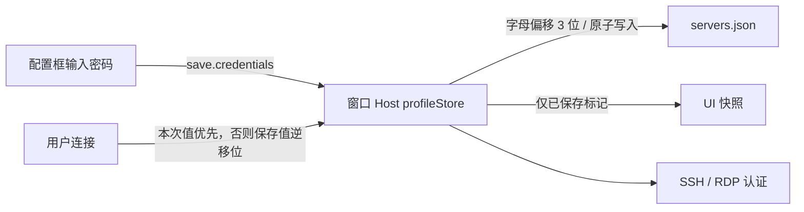
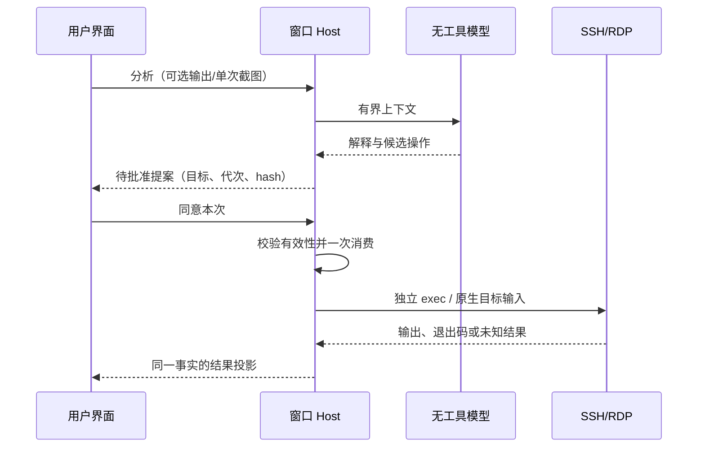

# 177 · SSH 服务与 Windows 远程运维工作台

状态：桌面开发版已接线；真实 Windows/Linux 服务器验收由用户在应用中手动执行。开发测试不连接示意图里的服务器。安装包与真实 RDP 画面/输入尚未验收，不能据本机控件测试宣布已通过。

## 产品与约束

入口位于「浏览器」下方。服务器卡片支持 Windows/Linux、新增/编辑/删除、分组字段及名称/地址/分组搜索。SSH 与 RDP 可分别填写地址、端口和账号，分别连接；不部署远端 Agent，不改动既有远程 workspace 的 POSIX 限制。

展开入口显示按服务器归组的运行终端，点击恢复同一 channel，右键可以重命名、复制连接信息、关闭。关闭精确作用于目标终端。切主视图或收起列表只改变显示，不关闭 Host 的连接。

连接页布局为左上终端/Windows 桌面页签，右上 AI，底部通栏本地/远端文件管理。两组分隔条保存尺寸，底部可以折叠。后台输出和 AI 结果不切换用户主视图或焦点。手机/Web 不显示本机 SSH 工作台入口。收起侧栏后，SSH 与浏览器工具栏根据 DesktopTopOverlay 实测交互区右边界避让；浮层是尺寸事实的唯一所有者，主题、缩放与更新按钮改变时重新测量，不用固定左边距猜测。

服务器新增/编辑提供 SSH 密码及 Windows 专用 RDP 密码。按用户指定采用凯撒偏移 3 位：ASCII 大小写字母各自在 26 字母表内循环移动 3 位，数字、符号及 Unicode 字符保持原样。Host profileStore 在 servers.json 每条记录的 credentials 中保存移位结果，连接前逆移位；不迁移现有无密码记录。编辑空框未改动表示保留，输入新值表示替换，「清除已保存密码」表示删除。连接框空白默认使用对应已保存密码，非空仅覆盖本次；SSH 与 RDP 不互相回退。快照只返回 hasPassword/hasRdpPassword，模型、UI 投影和日志不接收保存值。私钥口令仍只在本次连接内存中。



开发时保存请求与 Host schema 必须成套更新。Renderer HMR 不会替换已运行 Host；协议改变后须重启桌面再验证保存链路，不能仅凭新表单出现宣布生效。

资源指标默认显示 --。「采集指标（需批准）」生成一次只读命令，批准后执行；卡片显示 CPU、内存、系统盘比例及采样时间，明确为采样快照，不自动轮询 shell。

## 唯一所有者与接口

| 事实                             | 所有者                               | 恢复边界                                                  |
| -------------------------------- | ------------------------------------ | --------------------------------------------------------- |
| 服务器元数据、主机指纹、移位密码 | 窗口 Local Host 的 profileStore      | 应用配置目录 servers.json；原子替换；不保存私钥口令       |
| SSH/SFTP 连接与代次              | Host serverWorkbench/service.ts      | 运行期；重启离线；不自动重连/重放                         |
| 终端 channel、有界输出及连续位置 | Host terminals.ts                    | Sidebar/工作台共用投影；切页保留，窗口退出关闭            |
| 提案、hash、批准和执行           | Host approvalQueue/approvedExecution | 绑定服务器和连接代次，一次消费，五分钟过期                |
| 文件队列与断点                   | Host transferQueue/fileTransport     | 当前窗口运行期；断线可手动重连后续传；应用退出不恢复队列  |
| 模型上下文和分析请求             | Host assistant.ts                    | 每台服务器最多一个分析；终端末尾 12k 字符、最近 12 条消息 |
| RDP helper/窗口句柄              | Electron Main serverRdp.ts           | 只管理原生进程与投递；窗口退出回收                        |
| 页面选择、展开项、对话草稿       | UI hook/组件                         | 展示状态；分隔条通过现有组件保存布局                      |

公开接口为 services 的 IServerWorkbenchService，通道名 server-workbench。snapshot、perform、onDidChange、onTerminalData 通过 RPC 暴露。UI 从 hook 访问该服务，经公开包入口导入；平台文件选择器走 IPlatformService。独立远程 workspace Host 不注册此本机服务。

shared/server-workbench.ts 提供严格请求校验。Host↔Main 使用 server-desktop-request/result，并在 shared/validation.ts 校验。generateWorkspaceText 的 user 消息扩展为文本或有界 text/image 内容；仅接受内联 PNG，不从模型返回的 URL/本地路径读取截图。

所有新增文件归属现有 desktop/services/shared/client/ui 模块，遵循现有架构策略，不新建跨包实现导入。

## 审批是执行入口的硬约束

- 模型使用 generateWorkspaceText，tools 固定为空。模型只能返回解释和候选命令/桌面动作，不开放 Bash、PTY 写入、CUA、node_repl 或文件工具。全局「完全访问」不能替代此处批准。
- UI 展示服务器、账号、shell、cwd、命令/动作原文和目的。用户「同意本次」后，Host 校验 serverId、generation、requestId、内容 SHA-256 和过期时间，再一次性消费；多条建议分别批准。
- AI exec 与人工交互终端独立，不共享 cd/环境变量。结果在右侧提案及左侧命令记录展示；非零退出标记失败。输出保留末尾 64k，执行限时两分钟；停止和超时不承诺回滚远端已发生的效果，不自动重放。
- 编辑提案须拒绝旧项并建立新项。断线、重连、切换所选服务器、关闭终端、停止 AI 使相关未完成提案失效。迟到模型结果按代次和 AbortSignal 丢弃。
- 人工终端输入是用户自身执行意图。模型无法调用此写入路径。主机指纹首次/变化需用户核对；不会静默信任。
- 读取终端输出和单次桌面截图各有显式勾选，默认关闭。连接桌面不等于授权持续截图。
- RDP 截图附带用户输入 revision，AI 动作批准绑定该值；原生窗口在投递前再次比较。用户手动键鼠接管使旧动作失效，即便 UI 尚未来得及刷新。UI 定期 probe 后同步取消旧桌面提案。



## SSH 与 Windows 桌面

SSH 使用仓库已有 ssh2，支持保存的密码或本次密码覆盖、私钥与本次私钥口令。Linux 为 sh 交互 PTY；Windows 为 PowerShell/CMD。调整尺寸、Ctrl+C、双终端与单独关闭均通过真实 channel。握手可取消，断线回收 SFTP 与终端，晚到连接不能恢复旧代次。

Windows 内嵌 RDP 由自研 ServerRdp.cs helper 调用系统 MSTSCAX.MsTscAx.10；不附带微软 DLL、不依赖外装远控软件。其他本机平台 RDP 明确不可用。目标机器需要可用的 RDP 服务和 SSH/SFTP 服务，两者独立。

helper 构建由 prepare-server-rdp.mjs 接入 pre-dev 与 production build。开发缓存位于 LOCALAPPDATA/ZCode-CE/server-rdp/源代码hash，resources/server-rdp 写入产物和 manifest；Windows 安装包 extraResources 使用 server-rdp，Main 打包后从 process.resourcesPath/server-rdp 消费。源码工作区可能继承 Low 完整性标签，开发 helper 在用户正常完整性目录构建。

原生窗口 SetParent 到应用 HWND，使用局部区域物理像素坐标、SmartSizing 和不激活显示。弹窗/菜单及切视图时隐藏原生区域。手动控制在 RDP 子窗口内，AI 输入投递 IHWindowClass，不注入本机全局键鼠。截图仅 PrintWindow 此控件，失败报错，不退回本机全屏。RDP AuthenticationLevel=2，启用 NLA；磁盘、剪贴板、打印机和智能卡重定向关闭。

RDP 的 connecting 表示已发起连接，不表示已经认证成功；probe connected 才表示控件连通。服务器证书、NLA、远端画面、输入和截图效果由用户实机验收。RDP 不承诺镜像服务器现有物理桌面；不自动启用远端服务或修改防火墙。

## 文件管理与故障语义

本地和 SFTP 双栏有路径编辑/上级/刷新/隐藏文件/名称大小时间排序/多选，支持文件和目录双向传输、拖入上传、另存为、显式覆盖选项及队列。默认拒绝覆盖；不使用 shell fallback 上传。

最多两个并发、50 个等待项、约 100 条运行期记录。任务固定服务器、源、目标、方向及连接代次，选中服务器改变不能改投目标。流式传输不经过 Renderer/模型。UI 显示状态、字节进度、当前平均速度/估算时间、错误及最终 SHA-256；目录总量随遍历增长，因此目录 ETA 是估算。

远端按目录 handle 分页读取，达到 2000 项预算即关闭并提示截断；不把已截断列表当作完整目录传输。目录传输深度限制 32、项数 10000，不跟随符号链接，拒绝非法文件名与 Windows ADS 路径。

文件先写任务专属 .zcode-ID.part。完成后重读临时文件核对 SHA-256，再检查目标是否改变，提交最终名称；本地新文件采用排他 hard link 提交，已有目标只在用户允许覆盖时替换。远端覆盖要求 posix-rename 扩展，不支持则明确失败，禁止删除旧文件后伪装原子覆盖。SFTP 标准 rename 对并发竞争的最终语义依赖服务器实现，实机需确认。

断线保留当前窗口的 checkpoint 和临时文件，重连后「继续传输」会验证源的大小/修改时间、已完成文件 checksum 及临时前缀，再继续写；源或前缀改变即拒绝。用户取消清理当前任务临时文件，不删除用户目标。应用退出不承诺跨重启恢复，遗留临时文件不能被新任务盲目接管。

## 维护与验收

已读根 AGENTS.md、DESIGN.md、CONTEXT.md、remote-workspace.md、computer-use.md、tool-policy.md、架构受控上下文及技能；结论与现有 workspace/终端/CUA 边界一致。当前检出未找到目标包额外 AGENTS.md、.reverse/ 或技能引用的 docs/skills/feature-boundary-graph.md；不登记不存在的图谱入口。

回归入口（仓库根目录）：

```powershell
node --import tsx --test packages/desktop/test/serverWorkbench.test.ts packages/desktop/test/serverFileTransport.test.mjs
node --test packages/ui/test/serverWorkbench.e2e.mjs
node --test packages/desktop/test/serverRdp.e2e.mjs
pnpm typecheck
pnpm lint
pnpm fmt:check
pnpm architecture:check --changed
```

2026-10-27 验证快照：Host 六项回归通过，覆盖偏移 3 位保存、无密码旧记录兼容、重启读取、连接覆盖、清除、快照隔离、审批及真实回环 SSH。真实 Electron 工作台测试使用项目编译后的 Tailwind 样式，验证 1450/900 宽度反复收放侧栏、SSH/浏览器工具栏不重叠、Windows 密码字段与保存标记、终端树和逐次审批；后台浏览器不抢对话测试通过。根 typecheck、lint（104 条存量警告）、架构检查、变更文件格式与文档新鲜度通过。根 fmt:check 存在全仓存量格式问题（包括未改动的 packages/zcode-server-cli/tsconfig.json），不能将局部格式通过记为全仓通过。本轮不复验未改动的 SFTP/RDP helper，不建立真实运维连接或调用模型 API。实际开发桌面已重启，用无效域名临时配置验证密码保存/重新编辑后删除测试配置，未连接示意图服务器。

用户手动验收：添加服务器→核对 SSH 指纹→双终端与树关闭→AI 建议拒绝/批准→中文目录上传下载→独立连接 RDP→画面缩放/全屏/键鼠→单次截图分析→批准 AI 动作→手动接管后旧动作失效→断线重连→检查进程回收。当前未生成或验收完整安装包；发版前须从最终包路径复验 helper。

测试复用现有 Electron/ssh2，协议 fixture 仅监听回环；临时 profile 每份 32 MiB，文件 fixture 12 MiB，退出清理。不下载或复制新的第三方组件；helper 为本项目源码，使用系统组件，现有 ssh2/Electron 许可登记不变。

依据：[微软 SmartSizing](https://learn.microsoft.com/en-us/windows/win32/termserv/imsrdpclientadvancedsettings-smartsizing)、[微软 RDP 认证示例](https://learn.microsoft.com/en-us/windows/win32/termserv/embedding-the-remote-desktop-activex-control-in-a-web-page)、[ssh2 SFTP 协议接口](https://github.com/mscdex/ssh2/blob/master/SFTP.md)。
