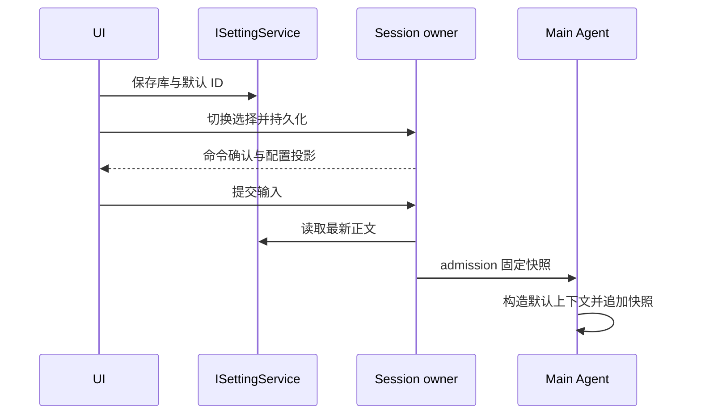

# 主提示词设置与会话选择

## 产品约束

设置的 Agent 能力分组管理主提示词（稳定 ID、名称、简介、正文、追加提示词），名称与正文必填，追加提示词可选。追加提示词是正文之外的第二块编辑区：单独保存、再次编辑时仍可分别修改，生效时由共享拼装函数把它接在正文下一段，用户不需要手动粘进正文。默认选项不追加正文且不可编辑。首次初始化提供代码审查、精简回答、方案设计示例；用户删除后不恢复。设置服务持久化提示词库与新会话默认 ID；每个会话独立持久化所选 ID，旧会话缺省为默认。修改全局默认不改变已有会话。

主提示词只追加到主 Agent 默认系统上下文，不替换 systemPrompt、不使用 outputStyle、不调整权限/工具/计划模式，也不继承给子 Agent 或工作流角色。远程会话读取目标 Host 设置，不新增跨 Host 同步。

## 所有者与时序

提示词库唯一所有者为 ISettingService；选择 ID 的唯一所有者为会话运行时及其配置持久化投影。UI 仅发命令并展示已确认的状态。输入在串行 admission 固定提示词内容；队列、恢复、重试及本轮后续模型调用使用同一快照。编辑后仅后续提交使用新版，忙碌时切换不修改当前轮上下文。guide 不改正在执行轮的系统提示词。

删除需确认，提示引用会话下一轮回到默认；失效 ID 统一解释为默认。保存失败保留表单，切换失败保留原选择。配置新增字段均向后兼容；旧数据无需数据库 schema 变更。

## 接口与 UI

共享 schema 校验库、选择 ID 与轮快照；V4 命令/事件/快照同步选择。正文与追加提示词的拼装只有一处（shared 的 `composeMainAgentPromptText`，被 `core/context/builder.ts` 的系统消息段调用），拼装结果为「正文 + 空行 + 追加段」，追加段全为空白时按未追加处理。桌面 continuous 与 Web replayable 使用相同会话事实。设置页支持增删改与默认选择，编辑态依次为名称、简介、正文、追加提示词四个输入区，追加提示词位于正文下方；聊天工具栏在权限控件右侧提供主 Agent 提示词选择器，展示名称、简介与管理入口，避免在输入框上方单独占用一行。遵守 DESIGN.md 的字号、主题、国际化及移动布局约束。

## 验收

- 初始化幂等、删除示例不恢复、增删改校验与重启保留。
- 会话独立选择、新会话默认、旧会话默认、编辑下一轮生效、删除引用回默认。
- 生成中切换、排队、恢复、重试不混用快照；最终模型请求包含正文且默认规则保留；子 Agent 不继承。
- 追加提示词：编辑页两个输入区互不覆盖；保存后下一轮系统提示词里追加段紧接正文之后；未填或全空白时不产生空尾段；该字段出现前落盘的库与旧轮快照仍能解析。
- E2E 覆盖新增 → 选择 → 发送 → 模型请求 → 重启/重连，检查手机布局、键盘操作与深浅主题。
- 执行相关测试、typecheck、lint、fmt:check、architecture:check，报告真实结果。

## 运维与验证入口

库保存在既有用户设置的 `mainAgentPrompts`（version=1、prompts、defaultId），首次读取旧设置初始化三个示例，空列表不会重新播种。会话选择保存为 `main_agent_prompt` session entry；输入快照位于 canonical intent 的 `mainAgentPrompt`，null 明确表示默认模式。V4 与仍用于附件 facade 的 legacy session/send 都在提交前固定正文。库上限 100 项，名称 100 字符、简介 500 字符、正文 50000 字符、追加提示词 50000 字符（可选字段，缺省即未追加），名称允许重复但 ID 唯一。配置读取失败明确报错，不用旧缓存正文偷偷继续。

改动 `mainAgentPromptSchema` 后必须重建内联了 shared 的运行产物才能在本机生效：`packages/server` 的 `dist/entry-http.js` 与 `dist/remote/*.cjs` 由 tsup 打包并内联 shared 的 zod schema，`packages/desktop/dist/**` 同理。只改 shared 源码、不重建服务端产物，设置服务仍用旧 schema 校验，保存会以 `unrecognized_keys: appendPrompt` 被拒——这正是「编辑页看见新输入框、保存却报未知字段」的成因（已实测：重建 + 重启后同一操作通过）。

针对测试：shared 的 `mainAgentPrompts.test.ts`、core 的 `mainAgentPrompt.test.ts`、bootstrap 的 `mainAgentPrompts.test.ts`，以及 UI 结构断言 `packages/ui/test/mainAgentPromptAppendField.test.ts`（追加提示词输入区的位置、字段绑定、新建初值与中英文键）。UI 集成测试从仓库根执行 `node --import tsx --test packages/ui/test/mainAgentPrompts.e2e.mjs`，通过 `ZCODE_E2E_CHROMIUM_PATH` 可指定已安装的 Chromium；缺省使用 Playwright 管理的浏览器。测试使用隔离 profile 和临时设置，不连接真实模型或用户配置；最终 provider 请求由真实 AgentRuntime loop + 假模型端口测试检查。
