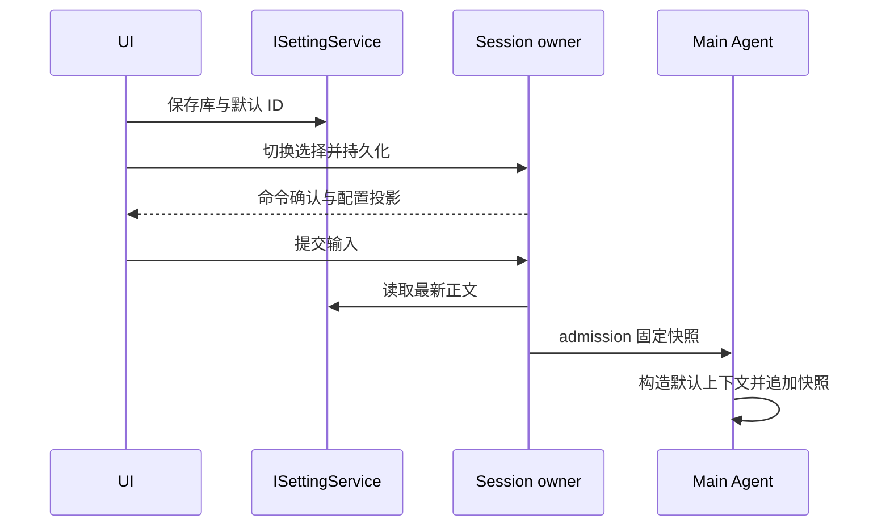

# 主提示词设置与会话选择

## 产品约束

普通主助手内置英文通用工程提示词，适用于任意工作区，不预设语言、框架、目录或包管理器；默认用简体中文交流，遵循用户语言与输出风格要求。正文覆盖项目识别、约束文档、规格先行、必要注释、授权边界、工具调用与故障恢复、验证和交付。它属于默认系统上下文，不是首次初始化才写入设置的示例，因此已有默认会话也能使用；不覆盖用户保存的提示词库或默认选择。

内置正文及工具指南由 `packages/shared/src/assistant-prompts/` 单点持有，通过 shared 公开入口供 CLI 使用；`ContextBuilder` 仅在普通默认身份分支注入通用正文。自定义 `systemPrompt` 保持替换语义，子 Agent、工作流角色和 IDE 输入不注入通用正文；IDE 使用独立正文，见 [IDE 规格](187-ide-mode.md)。用户选择的主提示词仍追加到普通默认上下文之后。

工具示例使用统一的 `Tool: 名称` / `Arguments: JSON` 格式生成。示例只说明参数形状，真实调用必须使用当前工具通道、Schema、主机路径、返回 ID 和权限；工具未暴露时不得调用。基础编码指南由主助手与 IDE 复用，扩展指南仅供普通主助手使用。核心持久 `js` 与官方 fresh-kernel `mcp__node_repl__js` 分别说明，不混用变量生命周期、初始化方式和用途。local 工具搜索通过 `DeferredToolCall` 调用已发现的延迟工具；native 模式按实际定义直接调用。角色限定工具与工作流、自动化、团队工具必须满足各自的角色、技能和授权条件。

设置的 Agent 能力分组管理主提示词（稳定 ID、名称、简介、正文、追加提示词），名称与正文必填，追加提示词可选。追加提示词是正文之外的第二块编辑区：单独保存、再次编辑时仍可分别修改，生效时由共享拼装函数把它接在正文下一段，用户不需要手动粘进正文。默认选项不追加正文且不可编辑。首次初始化提供代码审查、精简回答、方案设计示例以及多智能体模式；前三种示例删除后不恢复，多智能体稳定 ID 缺失时由设置读取迁移幂等补齐，已有同 ID 的用户正文不覆盖。设置服务持久化提示词库与新会话默认 ID；每个会话独立持久化所选 ID，旧会话缺省为默认。修改全局默认不改变已有会话。

主提示词正文只追加到主 Agent 默认系统上下文，不替换 systemPrompt、不使用 outputStyle，也不继承给子 Agent 或工作流角色。正文自身不调整权限、工具或计划模式；内置多智能体模式的稳定 ID 另由既有运行时模式门收窄派生工具，见 [多智能体规格](184-agent-team.md)。远程会话读取目标 Host 设置，不新增跨 Host 同步。

IDE 模式是独立的每轮执行配置，见 [IDE 规格](187-ide-mode.md)：提交携带 ideContext 时临时使用内置 IDE 提示词并收窄工具能力；不改写本库、会话选择或权限。退出后后续普通输入恢复原选择，已排队输入使用提交时的快照。

IDE 布局中的右侧辅助对话保持自己的主提示词选择，不继承主对话的 IDE 执行配置；选择与提交仍由该辅助会话 owner 保存，主对话继续使用 IDE 助手。

## 所有者与时序

提示词库唯一所有者为 ISettingService；选择 ID 的唯一所有者为会话运行时及其配置持久化投影。UI 仅发命令并展示已确认的状态。输入在串行 admission 固定提示词内容；队列、恢复、重试及本轮后续模型调用使用同一快照。编辑后仅后续提交使用新版，忙碌时切换不修改当前轮上下文。guide 不改正在执行轮的系统提示词。

删除需确认，提示引用会话下一轮回到默认；失效 ID 统一解释为默认。保存失败保留表单，切换失败保留原选择。配置新增字段均向后兼容；旧数据无需数据库 schema 变更。

## 接口与 UI

共享 schema 校验库、选择 ID 与轮快照；V4 命令/事件/快照同步选择。正文与追加提示词的拼装只有一处（shared 的 `composeMainAgentPromptText`，被 `core/context/builder.ts` 的系统消息段调用），拼装结果为「正文 + 空行 + 追加段」，追加段全为空白时按未追加处理。桌面 continuous 与 Web replayable 使用相同会话事实。设置页支持增删改与默认选择，编辑态依次为名称、简介、正文、追加提示词四个输入区，追加提示词位于正文下方；聊天工具栏在权限控件右侧提供主 Agent 提示词选择器，展示名称、简介与管理入口，避免在输入框上方单独占用一行。遵守 DESIGN.md 的字号、主题、国际化及移动布局约束。

## 验收

- 普通主助手最终模型请求包含英文通用正文与实际工具示例；用户附加角色仍生效。IDE、自定义 systemPrompt、子 Agent 与工作流身份不混入通用正文，退出 IDE 后后续普通轮次恢复通用正文和用户选择。
- 示例从最终内置文本提取，逐条校验当前工具的运行时输入 Schema、模型必填字段和不支持的字段；IDE 示例名称必须全部属于现有九种基础工具白名单。浏览器初始化示例仅校验参数与语法，不声称执行了浏览器操作。
- 文档与命令随项目识别，不把本仓库的 pnpm 命令、路径或技术栈写成对其他项目的要求；未保存草稿、部分读取、stale、任务 ID、超时和权限拒绝有明确处理方式。
- 初始化幂等、删除示例不恢复、增删改校验与重启保留。
- 会话独立选择、新会话默认、旧会话默认、编辑下一轮生效、删除引用回默认。
- 生成中切换、排队、恢复、重试不混用快照；最终模型请求包含正文且默认规则保留；子 Agent 不继承。
- 追加提示词：编辑页两个输入区互不覆盖；保存后下一轮系统提示词里追加段紧接正文之后；未填或全空白时不产生空尾段；该字段出现前落盘的库与旧轮快照仍能解析。
- E2E 覆盖新增 → 选择 → 发送 → 模型请求 → 重启/重连，检查手机布局、键盘操作与深浅主题。
- 执行相关测试、typecheck、lint、fmt:check、architecture:check，报告真实结果。

## 运维与验证入口

修改内置提示词或工具参数时，同步维护 shared 的指南、CLI 的示例契约测试与最终模型请求测试；不能只检查字符串常量而跳过最终请求。运行中的 CLI 已加载正文不会因磁盘源码变化自动替换，需重新构建对应 CLI 运行产物并在后续加载该产物的会话中验证；不为更新提示词强制终止用户正在执行的任务。

库保存在既有用户设置的 `mainAgentPrompts`（version=1、prompts、defaultId），缺失字段时初始化三种示例和多智能体模式；读取已有列表时只补缺失的多智能体稳定 ID，不重新播种其余示例。会话选择保存为 `main_agent_prompt` session entry；输入快照位于 canonical intent 的 `mainAgentPrompt`，null 明确表示默认模式。V4 与仍用于附件 facade 的 legacy session/send 都在提交前固定正文。库上限 100 项，名称 100 字符、简介 500 字符、正文 50000 字符、追加提示词 50000 字符（可选字段，缺省即未追加），名称允许重复但 ID 唯一。配置读取失败明确报错，不用旧缓存正文偷偷继续。

改动 `mainAgentPromptSchema` 后必须重建内联了 shared 的运行产物才能在本机生效：`packages/server` 的 `dist/entry-http.js` 与 `dist/remote/*.cjs` 由 tsup 打包并内联 shared 的 zod schema，`packages/desktop/dist/**` 同理。只改 shared 源码、不重建服务端产物，设置服务仍用旧 schema 校验，保存会以 `unrecognized_keys: appendPrompt` 被拒——这正是「编辑页看见新输入框、保存却报未知字段」的成因（已实测：重建 + 重启后同一操作通过）。

针对测试：shared 的 `mainAgentPrompts.test.ts`、core 的 `builtinAssistantPrompts.test.ts` / `mainAgentPrompt.test.ts` / `ideAssistant.test.ts`、bootstrap 的 `mainAgentPrompts.test.ts`，以及 UI 结构断言 `packages/ui/test/mainAgentPromptAppendField.test.ts`（追加提示词输入区的位置、字段绑定、新建初值与中英文键）。CLI 单跑测试按 [本地开发](local-setup.md) 在进程启动时加载源码解析钩子；示例契约测试使用真实工具注册条目的模型与运行时 Schema，且不执行示例中的命令、网络或调度操作。UI 集成测试从仓库根执行 `node --import tsx --test packages/ui/test/mainAgentPrompts.e2e.mjs`，通过 `ZCODE_E2E_CHROMIUM_PATH` 可指定已安装的 Chromium；缺省使用 Playwright 管理的浏览器。测试使用隔离 profile 和临时设置，不连接真实模型或用户配置；最终 provider 请求由真实 AgentRuntime loop + 假模型端口测试检查。
