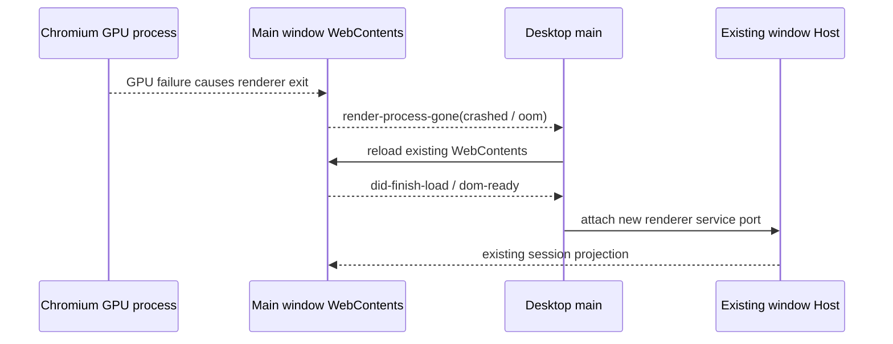

# Desktop Renderer Crash Recovery

## Problem

The Windows main window can remain open after its renderer process crashes, leaving only the native window background visible. The 3.16.3-ce.1 installation log showed a GPU child-process crash followed by `render-process-gone` for the main window renderer; the main process remained alive. The installed executable had no `Low Mandatory Level` label, and the last renderer heap sample was about 70 MiB, so this incident was not explained by the documented low-integrity startup failure or renderer V8 heap exhaustion. The local crash archive had no dump, so the underlying GPU or native failure remains unknown.

## Behavior

- When the main window renderer exits with reason `crashed` or `oom`, main reloads that window's existing `webContents` if the `BrowserWindow` is still alive.
- Normal exits, externally killed renderers, and destroyed windows do not trigger recovery.
- Main allows one reload at a time. A successful load or a failed main-frame navigation releases the in-flight guard. A synchronous reload error is logged and also releases the guard.
- Recovery keeps the existing `BrowserWindow` and window-scoped Host. The next `dom-ready` follows the existing renderer reload path, which reattaches the renderer to the same Host rather than restarting its Agent sessions.

## Owner and event order

The desktop main process owns the recovery guard for the main `BrowserWindow`. Renderer state remains owned by `webContents`; Host and accepted session state remain owned by the existing window-scoped Host.

## Acceptance scenarios

- `crashed` and `oom` request one reload for the existing window.
- A second crash event while that reload is pending does not start another reload.
- `did-finish-load` or main-frame `did-fail-load` clears the in-flight guard; a later independent crash can recover again.
- `clean-exit`, `killed`, and destroyed-window events do not reload.
- A synchronous reload failure is logged, clears the in-flight guard, and does not escape the event handler.
- Recovery does not create or dispose a Host process; existing `dom-ready` attachment handles renderer reinitialization.
