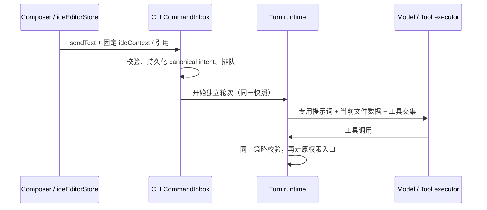

# IDE 模式：桌面编辑、文件联动与专用助手

## 范围

完成桌面打开、编辑、保存、冲突处理、工作区全局文本搜索与模式退出的闭环。手机布局、新建/重命名/删除文件、Git 扩展、文件 watch、跨重启草稿恢复留待后续。最多每工作区 20 个标签。顶栏进入 IDE，再点返回进入前的 office/coding；刷新后无记录则回 coding。

## 工作区全局文本搜索

IDE 左侧提供“文件／搜索”切换；在工作台内按 Ctrl/Cmd+Shift+F 打开并聚焦正文搜索，Ctrl/Cmd+F 仍为编辑器内查找。输入关键词后按 Enter 或点击搜索，支持区分大小写；默认按不区分大小写的字面文本匹配，不解释正则语法。结果按文件分组，显示相对路径、命中行号与高亮片段，每个匹配行展示一次。空关键词不请求，单行关键词最多 512 个 UTF-16 代码单元。

搜索读取当前展示工作区的磁盘文件，遵循现有文件索引的 .zcodeignore 和注入过滤器；不自动搜索其他工作区、聊天记录或未保存草稿。不跟随文件符号链接，真实路径必须位于搜索根目录内；跳过二进制、非法 UTF-8、超过 256 KiB 的文件、已删除或无权读取的文件。界面明确展示磁盘搜索与大小边界，跳过文件数和结果截断状态，不能把有界扫描描述为完整无命中。

FileService 复用现有索引刷新链路，新增 searchWorkspaceText({rootPath, workspaceIdentity?, requestId, query, caseSensitive?, limit?}) 与 cancelWorkspaceTextSearch({rootPath, workspaceIdentity?, requestId})。返回 matches（路径、相对路径、1-based 行/列、片段及片段中的命中范围）、searchedFiles、skippedFiles、truncated 和 cancelled。最多返回 200 个匹配行；扫描阶段最多处理 50,000 个文件、64 MiB 文本或 30 秒，达到边界必须返回 truncated。单文件读取复用严格编辑快照；原文件内容、换行和 BOM 不发生修改，列号与移除 BOM 的编辑器文档一致。

查询/结果和请求生命周期归 IDE 搜索控制器；按 workspaceIdentity?.trim() || workspacePath 及实际服务连接隔离。Host 按请求 ID 登记取消句柄，取消还需核对工作区身份和路径，不跨 RPC 传 AbortSignal；在索引刷新前登记、读取间检查取消、finally 释放。共享索引刷新继续服务其他消费者，取消后本次不再继续正文扫描。输入变化、新查询、切换工作区/服务、退出 IDE 或组件释放立即作废旧结果并请求取消；迟到响应不可覆盖新结果。失败显示本地化提示并保留关键词；旧 Host 缺方法时提示升级，不退回本机或 Agent 搜索。

点击结果走既有 ideEditorStore.requestOpen，携带完整工作区身份、远程连接与行号；重复打开只聚焦，已有脏草稿保留，位置按当前草稿的有效行范围夹取。文件树可通过切换“文件”查看定位后的目录；不展开右侧预览、不重建聊天实例。查询期间没有监听全盘文件变化；再次搜索重新刷新索引。

```text
关键词/Enter → 当前工作区搜索控制器 → FileService 登记 requestId → 共享索引刷新
  → 有界严格文本读取 → 匹配行快照 → 控制器接收仍有效的响应 → 分组结果
结果点击 → 既有 requestOpen（身份/远程连接/行号）→ 左侧标签与树定位
取消/切换 → 控制器作废序号 → Host 核对作用域后取消 → 迟到结果丢弃
```

验收覆盖：中文、大小写、字面特殊字符、BOM/CRLF 与行列；忽略目录、二进制/坏 UTF-8/超限文件、结果截断；新建文件立即可搜索；取消、过期回包、同路径不同身份与远端服务隔离。Windows 桌面 E2E 使用真实临时文件搜索并点击第二行结果，确认编辑器行定位、脏草稿、聊天实例和右侧面板状态保持正确。

## 状态与时序约束

### 文件联动与代码引用

单文件与批量预览入口在 IDE 模式下向 ideEditorStore 发出工作区隔离的打开请求。消息文件、工具结果、修改卡片、文件引用和文件树共用此入口；进入 IDE 收起右侧文件预览，保留其历史标签。左侧标签同时容纳可编辑源码与只读预览。差异快照独立于源码草稿，删除文件仍可看差异，无路径代码块不得伪造磁盘路径。路径携带来源 workspaceIdentity、workspacePath 和 remoteSessionId；目录展开及行号定位由当前打开请求驱动。

Windows 聊天链接可使用正斜杠；文件树定位生成的祖先目录必须沿用 workspacePath 的分隔符，与目录缓存的 key 一致，不能生成混合分隔符而只打开编辑器、不展开树。

源码选区右键“添加到对话”固定原始文本、绝对路径、起止行号及未保存状态，复用代码上下文附件。空选区禁用，添加只聚焦输入框、不发送、不覆盖已有文字；发送失败保留附件。序列化和解析必须完整保留缩进、空行和反引号。明确的会话文件修改结果触发磁盘版本核对：干净标签刷新，脏标签保留并提示实际变化；相同版本不重建编辑器，重复摘要不重复通知。不得用本机与远端时间戳比较判断文件变化，不新增全盘监听。

文件变更查询遇到 staleRevision 时，由既有 conversation store 恢复订阅；等同一 logEpoch 的新版本到达后最多重查一次。不得用延时猜测同步完成；工作区/会话释放、恢复失败或 logEpoch 改变时结束等待，不用旧 target 跨代重试。

### 每轮 IDE 执行约束

sendText 与 canonical input intent 新增可选 ideContext：version=1，activeFile 为 null 或 {absolutePath, hasUnsavedChanges}。绝对路径支持 Windows、POSIX 与远程主机路径。缺省保持普通模式；非法版本/路径拒绝。UI 发送前固定模式、当前文件与引用；CLI admission 是已接受输入唯一所有者，排队、恢复及重试携带同一快照。默认只发送路径和状态，不读取整份文件。UI 检查 Host 的 ideContextV1，Host 再检查实际 CLI 的同名能力标志；任一缺失时保留输入并提示升级，禁止删字段重试。

IDE 输入按独立轮次排队，立即发送仍停止旧轮再启动新轮。本轮临时使用内置 IDE 助手提示词（正文见 shared 的 ide-context.ts），不修改主提示词库、选择 ID 或会话权限。输入栏显示 IDE 助手；后续普通模式提交恢复用户选择。此能力与普通主提示词不同，会限制本轮工具面。

IDE 助手策略只作用于主对话。右侧辅助对话保留独立的主提示词选择器、模型与权限选择，发送时不附加 ideContext，也不自动注入左侧当前文件或 IDE 工具白名单；明确加入该辅助对话的引用仍按原规则发送。SessionPane 根据界面模式和 selectionSideChat 角色派生唯一的 ideAssistantActive，并同时提供给 Composer 的展示、提交和群聊视图；子组件不得仅凭全局 IDE 布局判定执行策略。辅助对话的提示词选择不改变主对话，切换辅助标签或收起面板不清空选择与草稿。既有辅助对话禁止 goal/edit/retry/fork 的边界保持有效。

验收须在主对话处于 IDE 时打开辅助对话，实际选择提示词并发送到隔离模型端口：主对话仍显示 IDE 助手；辅助请求使用所选提示词，不携带 IDE 上下文或 IDE 专用提示词，且工具能力沿用该辅助会话原有权限。

模型工具列表和实际执行入口共用策略：仅允许 Read、Edit、Write、Bash、可用的 Glob/Grep、AskUserQuestion、TaskOutput、TaskStop，并与既有权限取交集。刷新工具注册表不能恢复团队、子 Agent、工作流、技能、浏览器、联网、自动化、MCP/插件工具。Bash 仍受既有审批/沙箱约束；提示词禁止通过命令行绕过限制，但本功能不是通用命令沙箱。



桌面 continuous 与 Web replayable 复用相同 intent 和 owner/lease；UI 快照不成为服务端可变状态。验收覆盖左侧打开/差异/源码/树定位、右侧不展开与聊天实例不变、真实鼠标引用/移除/失败恢复、最终模型请求、执行拒绝/刷新/退出恢复、排队后切换文件、干净/脏文件刷新、删除及跨工作区同名路径。

interfaceMode 由全局 UI store 所有，沿用 localStorage 和广播；所有入口和广播经过统一退出守卫，检查本窗口所有工作区。有脏内容先确认，取消无变化，确认后清空。保存期间禁止关闭/重载/退出。确认期间冻结编辑操作。广播只在提交时抑制回广播，不在等待确认时阻塞其他字段。

ideEditorStore 按 workspaceIdentity?.trim() || workspacePath 管理标签、草稿、加载和保存；不持久化。读取/保存携带唯一请求标识，关闭/重开和切换工作区后的旧加载回包无效。加载期间禁止编辑/保存；重载失败保留草稿并可重试。重复点击只聚焦。保存确认仅推进提交快照基线，保存期间新增内容仍为未保存。

```text
文件树 → 打开/聚焦 → loading → 编辑快照 → 有效回包 → ready
编辑 → 草稿 → 冻结内容与版本 → saving → 锁内校验/写盘 → 确认提交快照
                                      └── 失败/冲突 → 保留草稿
退出 → 全窗口保存/脏状态检查 → 确认 → 清空 → 提交模式与广播
```

## 文件服务契约

既有 readTextFile 只读预览保持兼容：

```ts
readTextFileForEdit(params: { path: string }): Promise<{ content: string; version: string }>;
writeTextFile(params: { path: string; content: string; expectedVersion: string }): Promise<{ version: string }>;
```

version 是原始字节与文件身份、大小、修改/元数据时间的 SHA-256 指纹，UI 不解析，不允许无版本保存。读取通过同一句柄并核对读前读后及路径身份；变更时拒绝返回不一致快照。

保存复用共享文件锁和 atomicWriteText，锁内读取、校验、临时写入、替换前复核及写后版本生成。临时文件保留权限位，无截断回退，finally 释放锁和清理临时文件。双方使用本接口时，同版本并发仅一个成功；Agent/Bash/外部编辑器不共用锁，不承诺任意程序之间的绝对原子比较写入。

按 UTF-8 字节限制 256 KiB，拒绝二进制、非法 UTF-8、目录、符号链接和缺失目标；空文件可编辑。保留换行与 BOM，未修改不写盘。使用现有路径围栏、useWorkspaceServices 和只读权限；旧 Host 缺少接口时仅只读预览并提示升级，禁止无保护写入。

可区分错误前缀：file_edit_not_found、file_edit_not_a_file、file_edit_symlink、file_edit_binary、file_edit_invalid_utf8、file_edit_too_large、file_edit_read_conflict、file_write_version_required、file_write_conflict；权限/锁超时保留真实原因。UI 显示本地化摘要，不自动重试或覆盖。

## UI 集成

IDE 入口位于工作区顶栏公共区域，草稿新建任务和已有任务均显示，不依赖已创建会话；按钮显示 IDE 文字和进入/返回提示。文件树的“返回任务”复用同一退出守卫。分隔条使用组件库的 id 作为稳定标识，拖动验收需确认分栏宽度实际变化。

工作台轻量布局常驻，聊天 Panel 保持 key 与父层级；只增减左侧面板。完整聊天 props、错误边界、搜索及终端发送 provider 复用一份。编辑器和语言包懒加载，直接使用的 CodeMirror 包显式登记。主题/语言用 Compartment 重配置，保留光标和撤销；显式重载成功才替换文档。

### 切换性能与资源约束

文件树的活动文件定位保留祖先展开、选中和滚动行为。祖先已全部展开时，expandedPaths 必须返回原集合，不触发整份展开行重新计算。未变化的虚拟可见行复用渲染结果；行比较必须覆盖状态、样式和回调，不能遗漏 Git 更新、权限、主题或国际化。滚动测量先读取几何信息，再写遮罩样式；相同偏移不重复写入，吸顶遮罩继续与滚动同步。

已加载的可编辑文件之间切换时，当前编辑区域复用一个 EditorView，通过更换 EditorState 切换文档。首次文件读取的 loading 占位和只读预览允许卸载视图，编辑状态仍受面板缓存管理。ideEditorStore 仍是草稿和保存请求的唯一所有者；CodeMirror 状态仅缓存选区、撤销、解析及滚动等界面数据，不新增持久化或文件读写路径。缓存由当前 IDE 编辑面板持有，按标签 instanceId/docVersion 隔离；关闭、重载、工作区切换或退出 IDE 时使对应缓存失效。最多保留 4 个非活动编辑状态，缓存文档合计最多 1,048,576 个 UTF-16 代码单元；此预算限定文档和条目数量，不等同于整个 JS 堆大小。淘汰仅移除界面缓存，草稿保留在 store；返回未缓存文件时从当前草稿初始化。只读预览仍复用既有预览入口，不常驻隐藏 EditorView。

缓存恢复必须核对当前标签实例、文档版本及草稿，保存过程中继续输入不丢失；主题/只读状态按当前值重配置。语言异步加载以实际编辑状态归属校验，迟到结果不得应用到另一个文件；失败有提示。代码引用、Ctrl/Cmd+S、显式行定位、BOM/换行和脏草稿退出守卫保持有效。每工作区 20 个标签的产品上限不因缓存策略变化。

```text
点击已有标签 → ideEditorStore 切换活动路径（不读盘）
  ├─ 文件树：只补充缺少的祖先 → 选中/定位 → 更新变化的可见行
  └─ 当前 EditorView：保存旧界面状态 → 按实例/版本取缓存或草稿 → setState
关闭/重载/退出 → store 更新生命周期 → 编辑面板清理失效缓存
```

验收包括小文件反复切换的输入呈现延迟、EditorView 数量/实例复用、缓存内选区与撤销保留、淘汰后草稿恢复、关闭重开/重载失效、主题/只读/语言迟到、树定位和 Git 状态更新。性能对照使用同一构建模式、同一组文件和无 CPU profiler 的 Event Timing；开发构建与生产构建分别记录，不将单测通过作为变快的依据。

JS/TS/JSX/TSX、JSON、HTML、CSS、Markdown、Python 按正确工厂加载；未知扩展名纯文本，语言包失败有提示并保留编辑。保存/重载/关闭有可访问名称、测试标识、键盘操作，支持 Ctrl/Cmd+S、拖动分栏、浅深主题及中英文。

## 验收与交付

- 非空/空文件正确加载；重复点击保留草稿；失败可重试；旧响应无效。
- 核对最终磁盘内容；保存期间继续输入仍为脏状态；保存不重入；失败保留草稿。
- 同版本并发仅一个成功；同 mtime 改内容、外部替换/删除拒绝旧版本；失败不截断文件。
- UTF-8 字节上限、非法编码、二进制、目录、符号链接、缺失文件被拒绝；换行/BOM/权限位保留。
- 13 种登记扩展名加载成功；主题变更保留选区和撤销；语言失败有提示。
- 关闭/重载/退出取消无变化、确认才丢弃；检查全窗口；广播取消无回环。
- 桌面切换模式保留聊天实例/草稿/会话/操作；实际验证文件树、快捷键、保存和拖动。

node:test 覆盖 store/controller、模式守卫、语言加载、代码引用、协议与真实文件服务。独立桌面入口为 `pnpm --filter @zcode/desktop test:ide-e2e`：构建 main/host/preload 与静态 renderer，加载既有 tsx 源码解析器以从 shared 公开入口复用测试标识，复用 playwright-core/Electron，在临时工作区与隔离数据目录核对磁盘。引导完成后再打开测试工作区，验收不依赖已有任务。本机假模型端口响应确定的 Read/Edit 请求，真实 CLI、权限与文件服务完成执行，不连接真实模型。运行此扩展验收前须构建当前 CLI（`node scripts/build-desktop-agent-cli.mjs`，已有配套载荷时可在 `pnpm typecheck:cli` 后执行 `pnpm --filter @zcode/cli build:desktop-agent`）；临时用户数据用后清理。

仅测试使用的 `ZCODE_IDE_E2E_REUSE_RENDERER=1` 允许复用 `.local/ide-e2e/renderer`；缺省重建。修改 renderer 后必须重建再使用此开关，缺产物直接失败，不能回落到用户正在使用的开发服务器。`VITE_ZCODE_E2E_STORE_BRIDGE=1` 沿用仓库的隔离导航与传输测试桥；发送失败场景仅在该构建通过 rejectBeforeSend 注入发送前拒绝，不伪造已接受事件。产品发行构建不得启用。

按 mise.toml 工具链运行 typecheck、lint、fmt:check、test、架构和文档检查。Windows 为本轮真实桌面验证平台；macOS/Linux、POSIX 权限位与本机无权限创建的文件符号链接断言须另行验证。工具链替代或全仓检查失败必须在交付记录中声明，不能用专项通过代表全仓通过。

E2E 实例通过既有 ZCODE_E2E_RUN_ID 标识，跳过系统协议与 Windows 右键注册，不能把临时启动参数登记到用户系统。通过 CDP 连接真实 Electron 窗口，工作区导航可用既有测试桥，文件操作必须走真实服务。

npm 依赖不登记为 copied component，notices 沿用发布流程；不自动提交、推送或发布。验证命令、平台限制与实际结果记录在 `.local/reports/ide-core/validation.md`，截图与桌面日志记录在 `.local/reports/ide-e2e/`。
